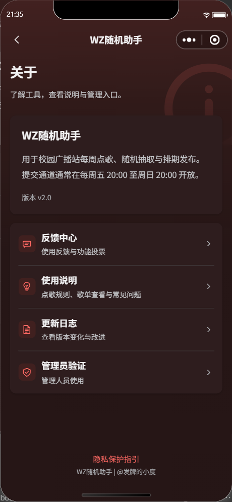
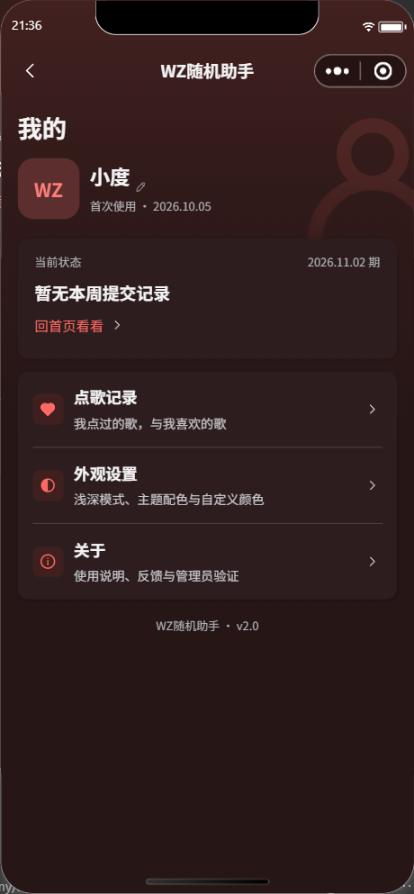
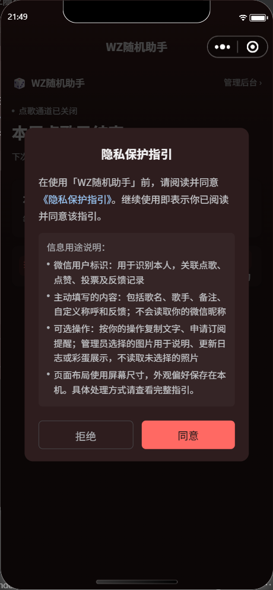
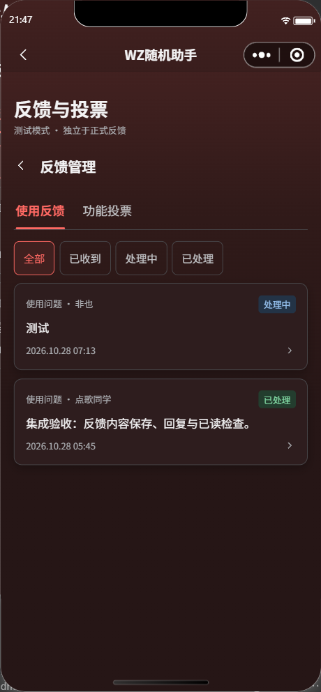

# 2.0 安全与可靠性修复验收（2026-11-01）

本轮开工备份：bb7f611，已推送。日期按美国东部时间记录，业务窗口按北京时间。用户确定审核包的数据域判断暂不调整、举报后续讨论；本轮没有上传、提审或发布小程序前端。

## 已完成的修改

- 投稿、审核备注、广播站发布说明、超管编辑、说明／日志发布、称呼／反馈／投票、彩蛋文案共七个服务入口统一：只有微信内容安全明确返回 pass 才接受正式内容。risky／review 提示修改；接口异常、缺失结果不再放行。原测试域的权限闸门保留。
- 投稿、审核、抽取和说明补齐或修正 config.json 的 OpenAPI 声明。审核与抽取声明订阅发送权限。保留一个仅正式超管可用的只读 checkTextSafety 自检动作，不保存检查文本、不写业务记录，测试参数也不能跳过该自检。
- 通过已部署 SDK 实际源码与拦截请求验证：查询 get 携带 transactionId，查询 count／update／remove 不携带，文档 update 携带。因此投稿上限改用限量 get；审核单日跳过／发布状态更新、抽取选中状态均改逐文档事务更新。注入中途失败可完整回滚。
- 抽取与验证码生成各自按数据域／周键使用串行锁文档；并发操作不会生成第二份有效排期或第二组验证码。抽取提交前重查候选资格，通知失败不再把已提交抽取误报为失败。
- 自动验证码生成接入正式／测试集合隔离及角色校验。无用户调用只接受平台上下文 SOURCE=wx_trigger 的正式定时任务，不相信事件自报 Timer／来源；不再把完整验证码写入日志。
- 七处延时导航统一可取消，卸载后清理且触发前确认页面仍处于栈顶。首页、歌单、登录、编辑器等迟到结果不再更新卸载页面；已经同意的订阅保存仍完成。
- 彩蛋管理与反馈管理补自定义导航、返回和同一导航占位；抽屉字段接入统一键盘层，避免原生与自定义避让叠加。双端真实输入法验收仍待用户设备完成。
- 隐私弹窗按实际使用的信息与接口改写，正文可滚动，操作按钮保留。产品版本由 utils/version.js 统一为 2.0；历史反馈版本、依赖版本、数据库 revision 不改写。

## 云端部署与验证

九个函数：checkWeeklyCode、adminAuditPlaylist、drawWeeklyPlaylist、manageHelpContent、autoGenerateWeeklyCode、superAdminConsole、manageChangelog、manageFeedback、manageEasterEggs。首次五个完整部署、四个单文件增量部署，经用户逐项确认后全部成功，九份下载源码／配置与本地一致。SHA-256 见[回读摘要](2.0-云函数回读摘要-20261101.json)。

原生 CLI 额外完整上传 checkWeeklyCode 与审核、抽取、说明、日志、反馈，下载文件仍一致；投稿真实检查恢复，但审核／说明／日志／反馈一度仍返回 -604101。随后用户在开发者工具对审核、抽取、说明、日志、反馈五项执行右键“上传并部署：云端安装依赖”，七个文字服务随即全部正常；不能仅归因于缓存，也不能以下载包包含 config.json 推定微信侧云调用已授权。参见[官方排错说明](https://docs.cloudbase.net/faq/knowledge/cloud-call-604101-permission-error)，权限可能有约十分钟缓存。

- 最终真实检查：七个文字服务全部明确 pass；同一违规测试文本逐个检查，七项全部 CONTENT_REJECTED，均 unavailable=false。只调用只读自检，没有保存为投稿、反馈或公告。
- 用户菜单上传后，再次下载五份部署包，22 个 JS／JSON 文件全部与本地一致，五个 SDK 均仍为 3.0.4。最终回读摘要与首次哈希一致。
- 代码与当时待验状态已先推送为 4a772b3；最终验收结果随本记录后续提交补推。
- 九函数均 Active，运行时仍 Node.js 16.13，超时未调整。验证码／投稿／日志／反馈仍 3 秒，审核／抽取／超管 60 秒，说明 20 秒，彩蛋 30 秒。未升级 SDK；超管仍原 4.0.2，其余原 3.0.4。
- 完整部署前下载的审核、说明、自动验证码 package.json 在线 license 为 ISC，本地为用户此前确定的 MIT；本次完整部署采用本地 MIT，依赖未更换。
- 正式 schedules 只读查询成功：三个已发布记录均为 20 首；未改历史数据、周日关联键、点赞关系和保存期限。未在正式域提交、抽取、发布、清理或发送测试通知。
- 已在用户指定的 Edge 网页控制台核验：自动验证码 autoGenCode 为 0 0 2 * * FRI *，自动抽取 autoDrawWeekly 为 0 0 20 * * SUN *。两项均完整保留，本轮没有修改或为测试手动触发生产定时器。开发者工具详情曾显示“暂无数据”，不能据此认定线上触发器不存在。

## 验证结果与限制

- node --test Progress/tests/*.test.js：191 项通过，0 失败；包含拒绝与权限异常不写入、事务中途回滚、并发抽取、生成测试隔离／重复执行、伪造定时来源、迟到响应及卸载取消跳转。
- 官方编译器：23 个 WXML、29 个 WXSS 通过。
- 源文件预算：123 个文件，655,393 字节，约 640.0 KiB，依赖引用完整。源码估算不能代替上传后的实际主包体积。
- git diff --check 通过；新增文档只保留脱敏结果与文件摘要。
- 未更改 utils/runtime.js，不自动将未获测试准入的账号降级到正式数据。审核包行为按用户决定暂不处理，也不宣称已完成普通审核账号验收。
- 微信公众平台的现网／提审隐私协议没有在本轮修改或验收，需与实际标识、投稿、称呼、反馈、投票、图片、订阅及保存期限对照；本地弹窗不能替代外部协议。
- 实际推送到达、下一次真实定时调用、iOS／安卓真实键盘与弱网、实际编译主包体积仍需发版前复验，模拟器与离线测试不能替代。

## 页面复查

以下为实际开发者工具模拟器，深色 WZ 红；均为测试域。关于／我的显示 v2.0。反馈旧记录保留原提交时的版本号。

| 关于 | 我的 |
| --- | --- |
|  |  |

| 隐私说明 | 反馈管理导航 |
| --- | --- |
|  |  |

彩蛋管理已实际检查返回／导航与列表布局，未将包含私人照片的检查截图纳入公开仓库。
