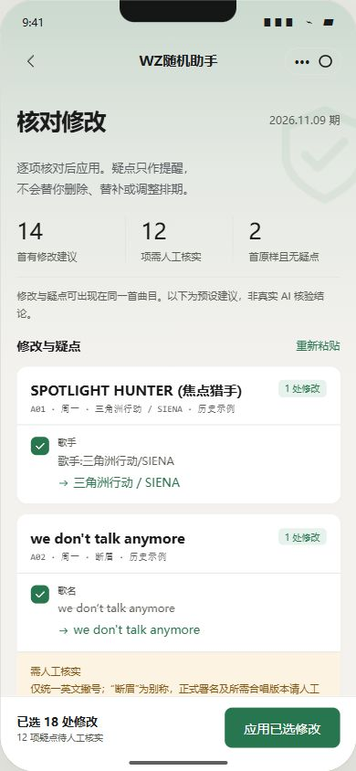
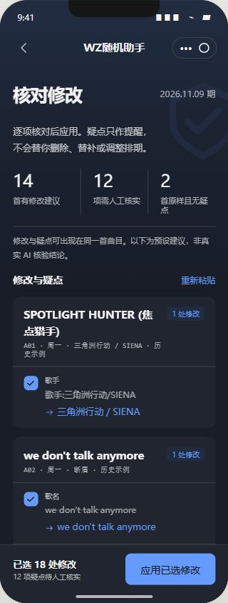
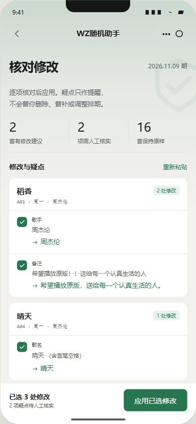
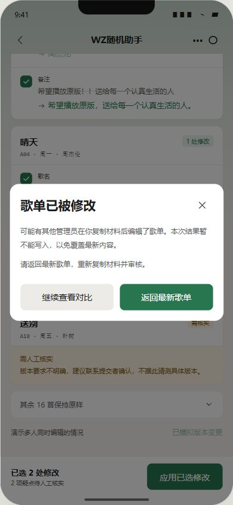
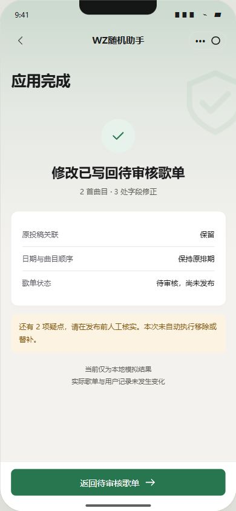
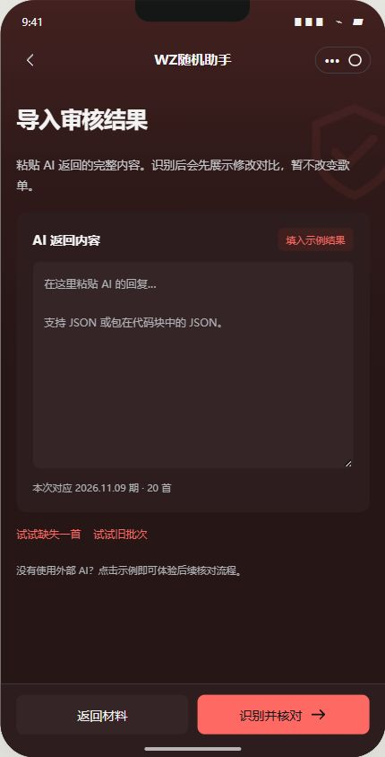

# AI 辅助审核 · K 版交互样稿

日期：2026-11-04。状态：**仅 HTML 模拟，待用户确认；未接入正式小程序。**

当前为 **K.1 历史样例扩充版**：20 条脱敏历史投稿，14 首 / 18 处预设修改建议、12 项待核实内容、2 首原样对照；其中 4 条额外加入演示错误，单独标注。修改与疑点允许重叠，不能将两者数量相加当作曲目总数。

## 预览

[打开独立样稿](mockups/K-ai-audit.html)。单文件，无外部字体、图标库或网络依赖；可直接在浏览器打开。左侧可跳转四个演示阶段、切换浅深色 / 松绿 / 晴蓝 / WZ 红，以及 320 / 390 / 430px 手机框宽度。

从「AI 辅助审核」进入后，依次点击「复制审核材料 → 粘贴 AI 结果 → 填入示例结果 → 识别并核对」。可逐字段取消勾选，再确认应用并返回原模拟歌单。左侧跳至“应用结果”会自动应用本页示例，仅为便于评审的快捷操作。

## 本轮范围

- 备份提交 `071e8c7` 已先推送。
- 仅修改样稿、截图和文档。不改 `pages`、`utils`、`cloudfunctions`，不部署或上传。K.1按授权只读查询正式历史样例；不写入正式 / 测试业务数据，HTML本身不访问业务云端。
- 首稿使用虚构内容；K.1 经用户授权，从正式历史投稿中摘取曲名、歌手和必要版本备注，重新编排为演示周。并不代表真实某周的抽取结果。4 条额外加错与原始历史示例分别标明，所有输出建议均为预设，未调用 AI 或联网核实，不能作为作品事实或适播结论。
- 复制按钮由管理员主动点击，仅写入本页模拟材料；没有自动读取剪贴板，也不会把内容发送给任何外部 AI。
- 复制材料附提示词、完整 20 首及短编号；批次固定为演示标识。正式接入应生成唯一批次、服务器核验导出快照与权限，不能照搬本页固定编号。

## 交互与视觉

1. **原审核列表入口**：轻量图标入口，原批量移除与发布按钮的位置保留。审核列表仅复现相关视觉，验证码等页签为上下文展示；批量移除仅说明沿用原功能，发布仅模拟本地状态。
2. **复制材料**：说明检查范围，展示实际将复制的完整文本。只导出曲目字段、日期和短编号，不包含用户身份信息；AI 不得自行增删、替换或调序，不确定时保留原文并提示人工核实。
3. **导入结果**：手动粘贴 JSON，兼容包裹代码块；缺失、重复、未知编号、旧批次、字段类型、长度和不完整 JSON 均显示错误，不猜测填充。当前示例包含14首/18处建议、12项疑点与2首原样对照，8条原备注或演示备注。
4. **核对修改**：原字段与建议纵向对比，每个字段独立选择。取消勾选只刷新该项与计数，避免整页反复淡入闪烁。首尾空格用文字补充说明，避免看不出区别。疑点与修正分开，其他内容可展开。
5. **确认应用**：模拟版本冲突时明确告知可能有其他管理员编辑，阻止写入。正常应用只改所选字段；回到同一份模拟歌单、保持日期顺序，不自动发布、删除或补位。
6. **公共风格**：颜色快照取自 `utils/theme.js`，浅色白卡与连续背景渐变，深色表面随主题着色；使用内嵌矢量图标。页面轻柔淡入，抽屉有开合 / 顶部拖动关闭，支持遮罩点击与 Escape；弹窗限制焦点，背景内容禁止交互与滚动。

本轮 HTML 的字段长度只用于演示结构校验，不作为已经定稿的正式接口约定。真实接入还需新增批量修正接口、内容安全检查、服务端逐项校验与审计日志；保留原投稿 / 曲目标识，并讨论名称修正后的重复判定规则。

## 首稿验证（K.1新数据验证见后文）

已在 Edge 实际点击检查：

- 主动复制成功提示；导入、代码块 JSON 识别、对比与确认回填。
- 缺 A20、重复 A01、旧批次、不完整 JSON 均阻止识别并明确提示。
- 取消歌手字段后只应用另外两处，模拟歌单歌手保持原值；正常三处应用成功。
- 模拟另一管理员更新版本后，旧结果无法写入；返回最新歌单后可重新审核。
- 晴蓝深色 320px、WZ 红深色 430px和默认松绿浅色 390px可用；装饰越界部分裁切，不允许横向滚动。仍是浏览器手机框验证，不代替真实 iOS / 安卓键盘与小程序验收。
- JavaScript 语法检查通过，`git diff --check` 通过。正式源码预算仍为 658,501 bytes（643.1 KiB），`Progress` 不进入小程序包。未因独立样稿重复运行无关业务回归。

## K.1 数据来源及复核

本轮备份 `50c79bd` 已先推送。使用微信开发者工具的云数据库只读查询，对正式 `submissions` 中2026-11-02之前的历史记录进行抽样，读取100条后挑选20条。服务器投影仅返回 `song_name`、`singer`、`special_note` 三个字段；返回字段也已核验，不读取投稿者标识、昵称、验证码或其他用户资料。

查询原始返回仅存本机被Git忽略的 `.cache`，没有提交整批记录。公开样稿仅保留选定的20条无身份音乐字段，没有个人留言、联系方式或用户关联；4条另加的前缀、空格和标点错误均标为“演示加错”。其余16条标为“历史示例”，不把人为构造的问题归因于用户。

| 类型 | 示例处理 |
| --- | --- |
| 冗余前缀 / 分隔符 / 标点 | 展示逐字段建议，保持原曲目关联 |
| 英文拼写或官方署名疑点 | 提供预设建议并要求核实，不冒充已查证 |
| 时长 / 来源 / 版本填入歌手栏 | 保留原文，提示补查音源，不编造歌手 |
| 指定现场版 / 合唱版本 | 保留要求，不擅自换成其他原唱 |
| 备注“无” | 演示留空，允许取消该建议 |
| Explicit 版本标记 | 原样保留，要求人工核实，不删除标记假装通过 |
| 完整曲目 / 合作演唱备注 | 两条原样对照，不为展示效果强行改动 |

Edge已用新数据实际走通“填入示例 → 识别 → 18处选择 → 取消一处 → 确认17处应用”：最终13首/17处，取消的歌手字段原样保留，12项疑点仍显示。晴蓝深色320px复核通过，控制台无错误。正式客户端源码、云函数、数据库内容和原抽取结果均未修改；仅查询样例源使用云端接口，HTML自身不访问业务云端。

### 当前 K.1 截图

## 首稿截图（保留排版对照，数量以K.1为准）

### 复制审核材料

### 逐项核对与选择

### 冲突保护与应用完成

### 导入页的 WZ 红深色效果

