# 反馈、投票与更新日志 · 2026-11-01

本轮由用户直接授权修改小程序，后续补充灯泡图标、关于／我的入口统一，以及首页歌单图标与描述精简。开工备份 **62b779e** 已推送。前端未上传或发布。

## 已落实的交互

- 功能投票：进行中的话题直接显示；结束的话题归入默认收起的“已结束”，点击平滑展开／收起。分页仍保留，展开区计数为已加载数量。
- 超管可结束、隐藏／恢复、删除进行中或已结束的话题。隐藏保留结果且可恢复；删除二次确认后不可恢复展示。服务端采用私有删除标记保留一致性，既有票关系不物理擦除，迟到的投票请求不能重新激活已删除话题。两个控制操作带revision校验；保留旧版endPoll不传revision的兼容。
- 反馈隐私提示移至填写卡片外，与投票规则提示使用同一字号／最小高度，首张卡片起点一致。
- 我的反馈：全部／已收到／处理中／已处理，服务端按本人及状态筛选再分页；切换从第一页加载，旧请求不能覆盖新分类。每条记录使用独立主题内容面、细线和轻阴影，首页“我的反馈”入口也加强层次。
- 关于四入口补齐矢量图标：反馈、灯泡说明、更新日志、管理员验证。我的和关于共用profile-entries.wxss，126rpx最小行高、24rpx上下留白、56rpx图标底面、34rpx路径；同屏实测第一条71.25px、后续含分割线72.05px，两页一致。长文可自然增高。
- 说明右上使用灯泡装饰，复用350rpx容器及前景／边缘柔化层，图标跟随主题且不拦截点击。
- 首页“查看已发布歌单”改为统一线宽的列表＋音符，往期保留历史图标；两种歌单入口均去掉重复副文案，跳转分支不变。

## 更新日志

关于新增入口。公开展示采用版本号＋发布日期时间线，与说明的单一折叠面区分。超管在日志页直接新建、编辑，草稿只出现在超管区。正文展开、四张缩略图／最多十张大图、签名读取、缓存、图片重试复用说明控制器；编辑器沿用原说明编辑器，额外提供版本和日期滚轮。

共享代码在utils/article-reader.js，原help页面为默认参数；日志传入manageChangelog和独立缓存前缀。编辑器只有kind=changelog才发版本／日期／revision，原说明保存参数保持原协议。发布使用共享确认框，取消不写；发现并修复原确认回调与Promise混用。日志修改需revision一致，失败保留草稿。

新服务manageChangelog与changelog_articles、test_changelog_articles独立，不写help_articles。版本／真实日期、文本安全、10图／2MB、图片命名空间、发布白名单字段与正式超管角色均由服务端校验。新集合最初默认“仅创建者可读写”，用户已在控制台改成“所有用户不可读写”（ADMINONLY）；两集合客户端直读实测均返回-502003，而云函数listPublished成功返回空列表。不得把空集合查询不报错当成权限验收。

当前日志集合为空，**没有发布或保存演示日志**。下面有内容的日志截图仅为模拟器内存排版样例，标题与摘要明确标注；已通过reLaunch清除，未写缓存或云端。

## 部署与兼容

- manageFeedback仅增量部署service.js，下载回读5个源码／配置文件均一致；旧线上service先下载备份且与Git开工版本一致。
- manageChangelog新增部署4个源码／配置文件并下载回读一致。首次创建时腾讯云Creating拒绝上传，待Active后重新逐项确认部署成功。两函数Active、Nodejs16.13、3秒超时。
- 新增两日志集合；新增正式／测试反馈owner+status+created_at降序索引、投票deleted+hidden+created_at降序索引，工具确认成功后已回读字段顺序。
- 不部署manageHelpContent、checkWeeklyCode、drawWeeklyPlaylist或adminAuditPlaylist。1.8说明与提交接口、开放时间、250上限、候选、抽取、订阅和彩蛋均不改；不在正式投票或投稿数据上试写。
- 服务端哈希及权限记录见../deployments/2026-11-01-feedback-changelog.json。

## 验证与限制

164项回归通过，包括投票隐藏／恢复／删除与旧页拒绝、越权／revision、本人状态分页、前端筛选竞态、发布确认、日志安全与原说明图片流程。官方wcc编译23个WXML、wcsc编译29个WXSS通过。源码包预算649729字节（634.5KiB），仍低于1500000字节；实际上传包和普通账号iOS／安卓真机另验。

原生模拟器已查看：反馈首卡对齐、进行中／已结束折叠与展开、筛选空状态、我的反馈卡片、关于浅深入口、说明灯泡、日志真实空状态／新建编辑／浅深内存样例、超管管理操作及首页入口。没有实机结论，不把内存样例当成云端发布验收。日志编辑复用说明的纯文字分段形式，本轮不引入富文本或新包。

## 截图

| 关于浅色／统一入口 | 关于深色 |
| --- | --- |
| 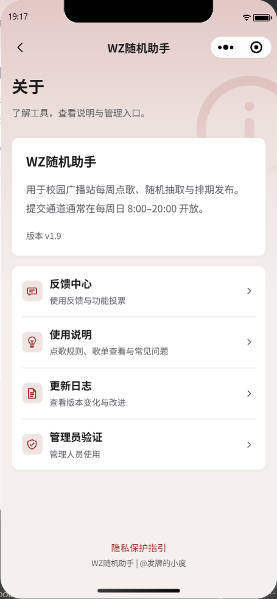 | 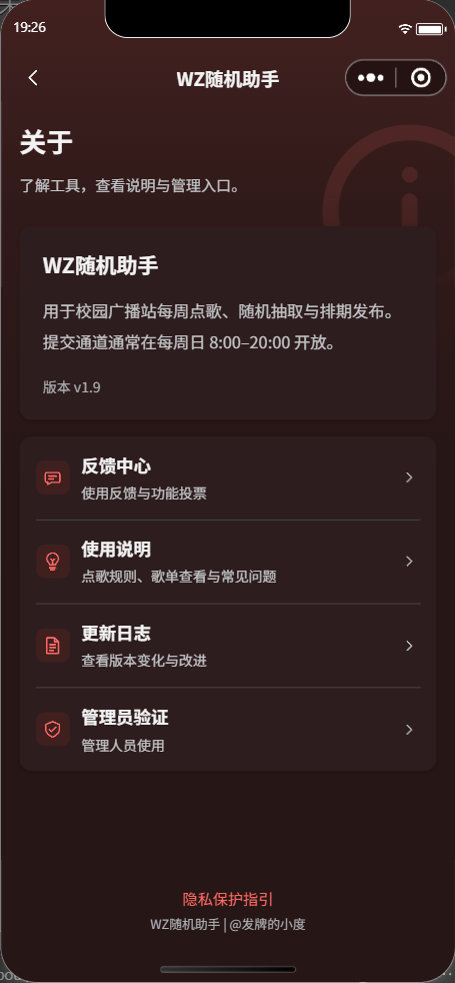 |

| 反馈提示在卡片外 | 进行中＋默认收起已结束 |
| --- | --- |
| 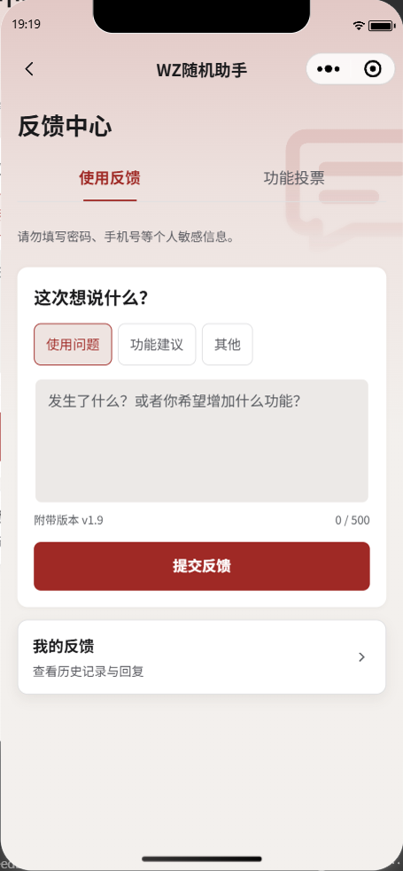 | 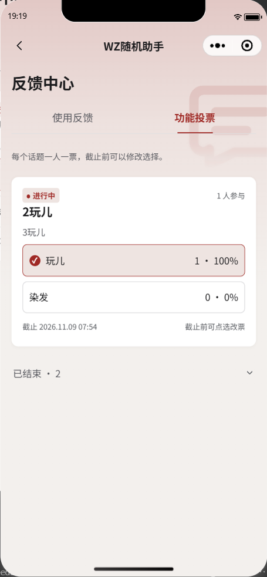 |

| 反馈状态筛选与卡片 | 已结束展开（深色） |
| --- | --- |
|  | 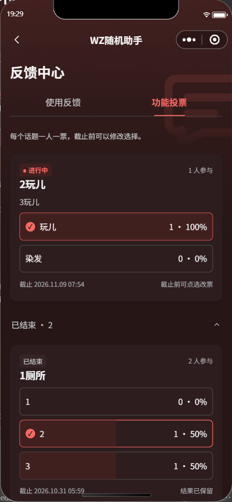 |

| 分类空状态 | 灯泡说明装饰 |
| --- | --- |
| 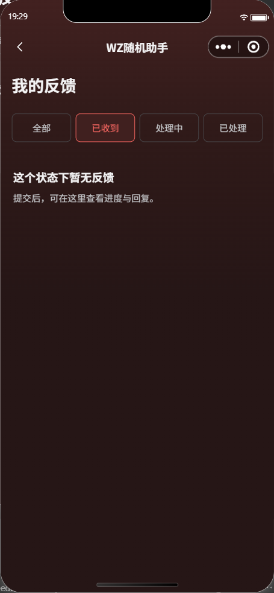 | 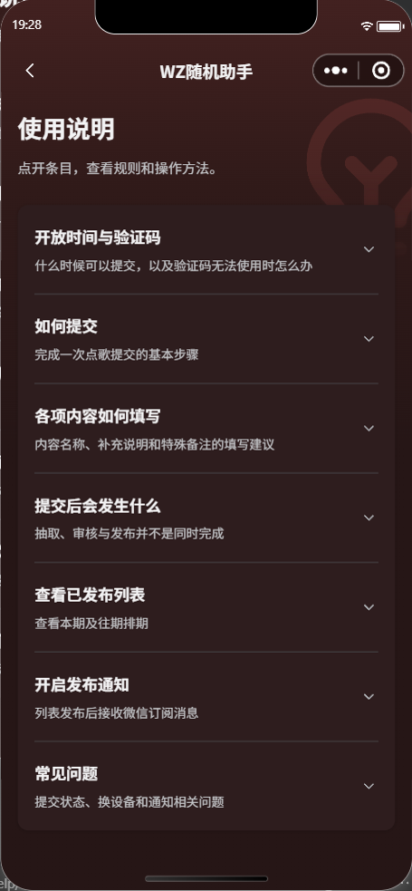 |

| 更新日志真实空状态 | 共享编辑器／新建 |
| --- | --- |
|  | 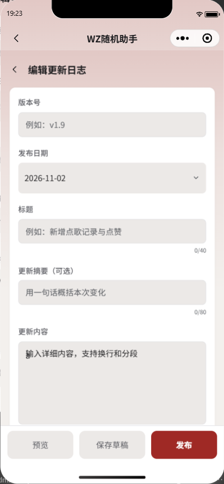 |

| 仅内存排版样例（浅色） | 仅内存排版样例（深色） |
| --- | --- |
| 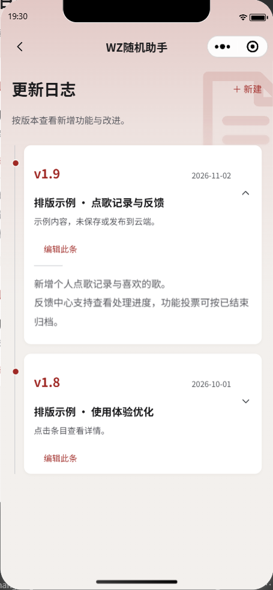 | 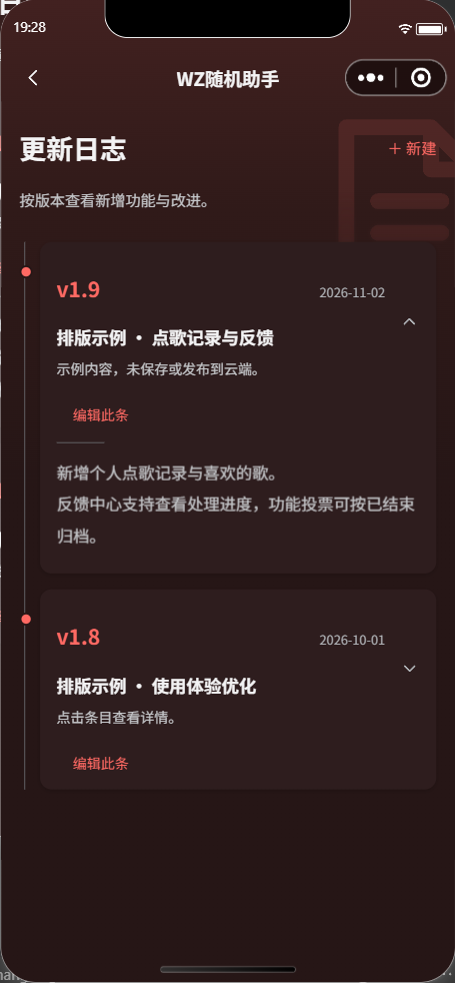 |

| 超管管理操作 | 首页新入口（截图处于状态初次读取） |
| --- | --- |
| 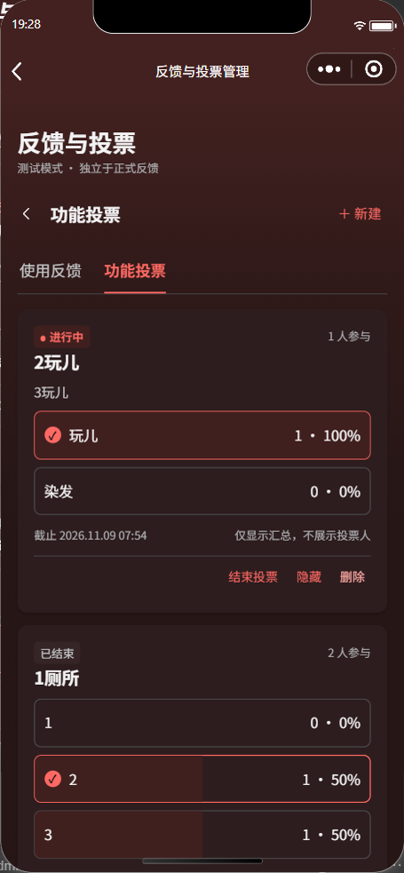 |  |
