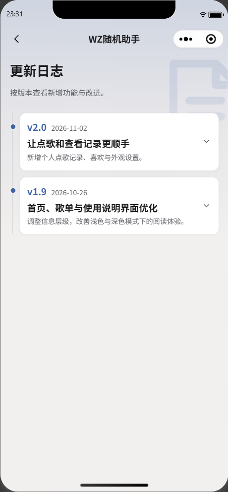
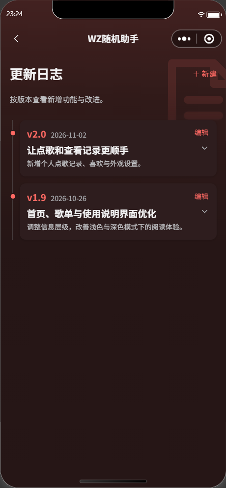
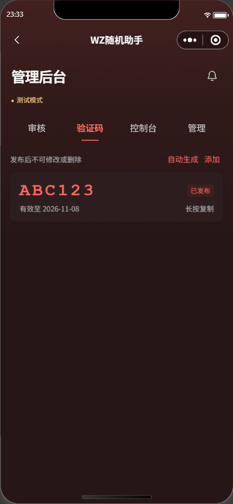
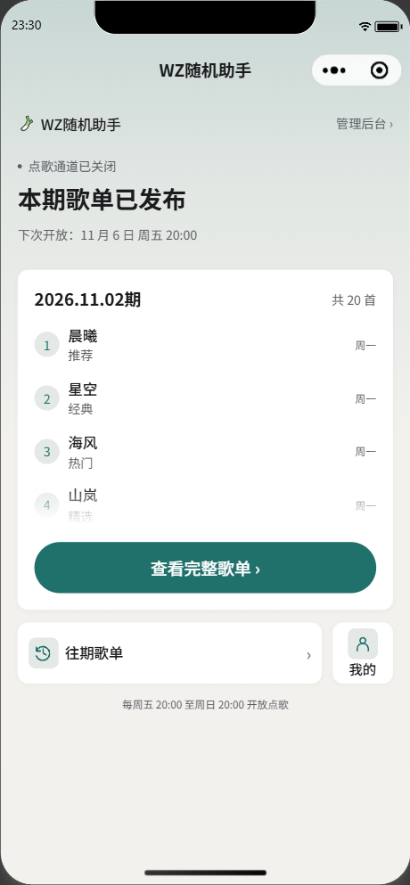
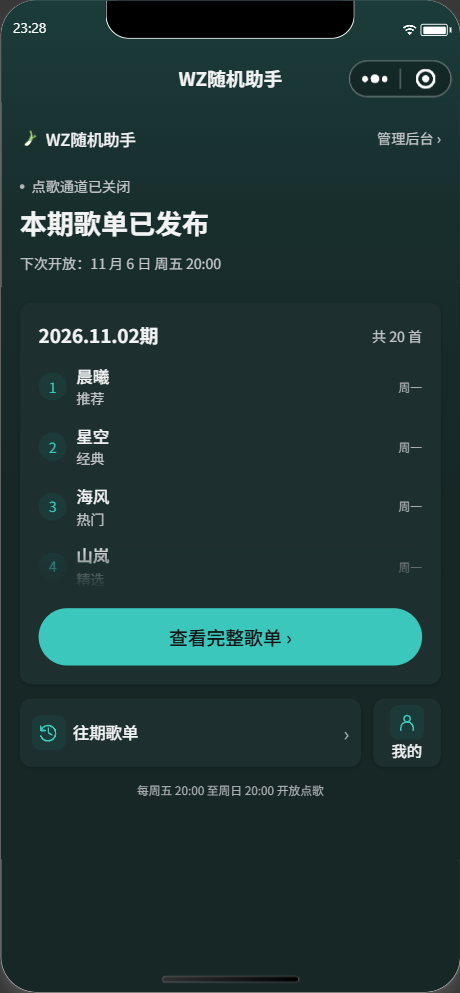

# 外观抽屉与界面细节 · 2026-11-01

开工备份 `849a573` 已推送。本轮为 2.0 前端细化，不修改或部署云函数，不上传、提审或发布前端。

## 修改

- 外观色值输入失焦后，原实现仍沿用最后一次键盘高度，部分客户端没有及时的零高度事件，导致抽屉持续上移。统一失焦缓冲结束后清除高度、目标和待执行滚动；迟到的旧高度事件不能重新抬起抽屉，新输入聚焦仍正常避让。保留切换字段时的 180ms 缓冲；安卓先报告键盘关闭、后恢复窗口时，不把缩小后的窗口保存为完整高度。折叠自定义、选择预设、关闭外观抽屉也主动清理。
- 验证码“已发布”标签改用主题强调色与其弱底色，不再混用固定绿色底色。业务成功／危险语义色保持原规则。
- 更新日志以版本＋日期为紧凑首行，标题／摘要相邻排列；超管编辑入口收至卡片右上方，保留独立点击目标。正文折叠、图片查看、新建与编辑流程保持。
- 仅自定义颜色精确为 `#39c5bb` 时，首页标题骰子换成手绘矢量大葱。六位 RGB 十六进制输入、大小写归一化、实时保存规则不改。用户提供的简笔参考用于形态参考，成品为透明 SVG，白色葱身、绿色叶片、深色轮廓，浅深模式下不反色。没有用 🥬 代替大葱。
- 图形沿用同一 `onSecretDiceTap` 入口、点击计数、渐强晃动、解锁定时器和骰子弹窗，主题切换不重置点击计数。其它自定义颜色及预设主题恢复骰子。无图标库或字体依赖，新增资源不足 1 KiB。

## 验证边界

195 项回归全部通过；官方编译 23 WXML／29 WXSS 通过；124 个打包源码文件共 658,087 字节（642.7 KiB），低于 1,500,000 字节源码预算。该数字不是开发者工具上传压缩包大小。

模拟器实际页面验证：色值字段模拟 300px 键盘高度后失焦，键盘占位回到 0，抽屉可滚动高度从 237px 恢复 537px；没有用真实手机键盘，iOS／安卓真实键盘关闭和字段切换仍待实测。测试覆盖未收到零高度、迟到正高度、安卓窗口恢复次序以及新字段聚焦。

自定义 `#39C5BB` 归一化后浅深首页均显示大葱；模拟器前两次点击倾斜由 9.2° 增至 14.4°，达到原测试域五次后原骰子弹窗正常打开。预设主题恢复骰子。外观偏好在检查结束后恢复到检查前的深色 WZ 红。

日志排版与验证码截图使用本地 `setData` 示例，不写入云端、不创建或发布验证码／日志。检查结束已重新进入首页清除页面内示例。

## 页面截图

浅色普通用户与深色超管日志，右上编辑入口仅超管可见：

WZ 红深色验证码“已发布”标签：

自定义 `#39c5bb` 的浅深首页；大葱原文件见 `assets/icons/leek.svg`：

