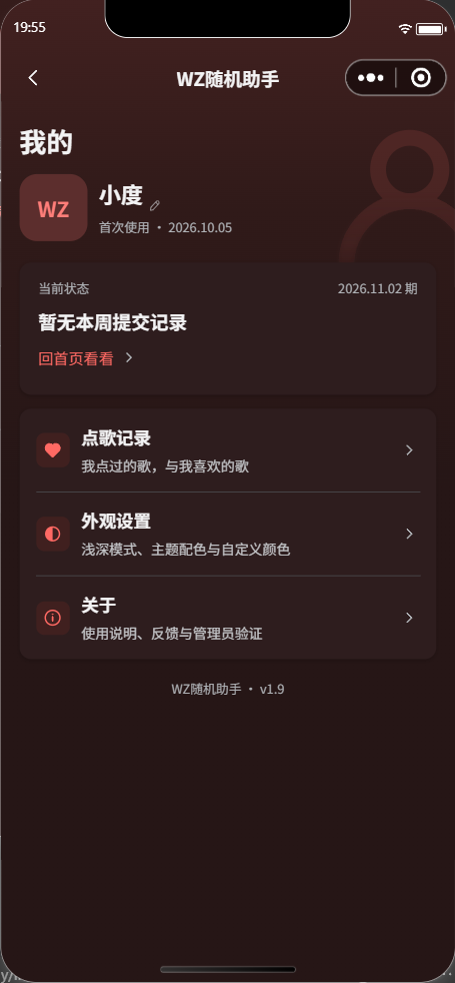
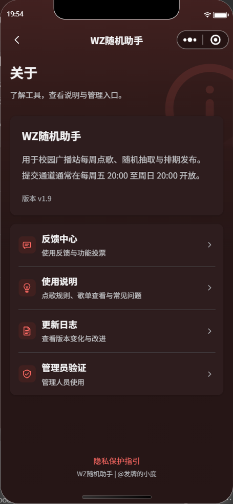

# 开放时间与周一期次 · 2026-11-01

开工备份b23ac70已推送。本轮用户确认将正常收歌改为北京时间每周五20:00（含）至周日20:00（不含），共48小时；随后确认用户端以播出周一日期显示某某期。

## 规则与实现

- 前端首页及我的共用正常窗口判断；服务端checkWeeklyCode独立校验同一规则。强制关闭仍高于强制开放，客户端传时间或canSubmit不能绕过服务端。
- 周五、周六、周日投稿仍归属同一周日week_key；每人每周一次、同名判重、250个pending候选不变。超额仍保存overflow并计数，不进入抽取池。周五02:00验证码任务、周日20:00抽取及通知不改。
- 首页关闭态的下次开放显示周五20:00，开放态倒计时从48小时开始；周五开放后检查即将抽取的本周日期次，不因上周已发布歌单阻挡新投稿。我的同步切换提交周期。
- 首页、关于、管理员正常通道说明、使用说明默认内容与线上正文同步新时间。
- period-label.js仅把原周日键加一天格式化成YYYY.MM.DD。首页、我的、点歌／喜欢记录及入选安排详情显示周一；歌单原播出范围已是周一至周五，保留原排版。所有查询、缓存、历史跳转、点赞期限、候补和数据库键继续使用原周日值，无数据迁移。
- 例：内部2026-11-08，显示2026.11.09期，播出范围2026.11.09—11.13；跨年2023-12-31显示2024.01.01期。历史记录也用同一转换，不修改原记录或延长保留期。

## 云端与回退

checkWeeklyCode、manageHelpContent都仅增量部署index.js。两份线上index部署前与Git备份一致；部署后回读与本地一致。其余打包文件与线上备份保持一致，checkWeeklyCode仍3秒、manageHelpContent仍20秒，Nodejs16.13。manageHelpContent线上package.json存在旧ISC与本地MIT的既有元数据差异，本次没有部署包元数据或依赖，不能把它写成全目录字节一致。

正式help_articles仍9条、测试仍7条，仅各一条“开放时间与验证码”的正文替换旧时间。更新带_id、标题、原content条件，匹配／修改各1条，回读逐条核对只有预期文案变化。修改前备份在本机%LOCALAPPDATA%/dgzs-backups/20261101-opening-window，未入公开仓库。

服务端已生效；**旧1.8首页内置旧开放判断，周五／周六表单需要发布新版前端才会展示**。旧版周日原请求格式和数据仍兼容，未上传／提审／发布前端。没有向正式投稿集合提交演示内容。

## 验证

171项回归通过；新增真实服务入口的受控时钟测试覆盖周五19:59:59.999／20:00、周六零点、周日零点／19:59:59.999／20:00、周一关闭、跨年、跨日防重复和共享计数、250候选及验证码、强制开关优先级、客户端伪造时间；展示测试覆盖周一转换、跨年、保留原查询键和原对象。

官方编译23WXML／29WXSS通过，122个运行源码文件650675字节（635.4KiB）。项目静态检查包括自有JS语法、JSON解析和WXML闭合；diff检查通过。

当前实际非开放时段调用测试域checkWeeklyCode，返回新窗口拒绝文案，在时间校验阶段结束，没有写投稿。模拟器确认首页下次开放11月6日周五20:00、我的2026.11.02期、歌单2026.11.02—11.06、关于新时间。iOS／安卓普通账号、新版实际上传包和完整发布流程仍待后续验收。

用户随后报告旧版提交出现多次“系统繁忙”，进入独立并发／超时审计；本轮不擅自放松唯一性、验证码或250规则。不能仅根据通用提示断定是限流。

## 截图

| 首页新开放提示 | 我的周一期次 |
| --- | --- |
|  |  |

| 关于时间说明 | 歌单播出范围 |
| --- | --- |
|  |  |
