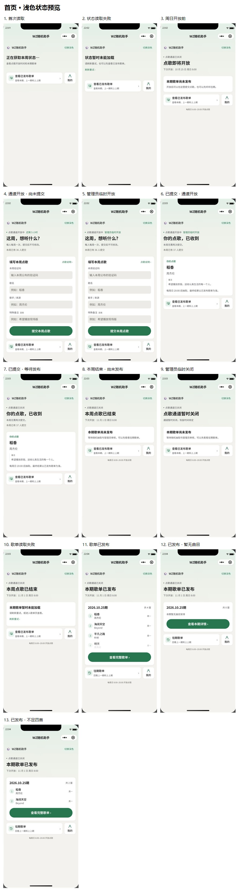
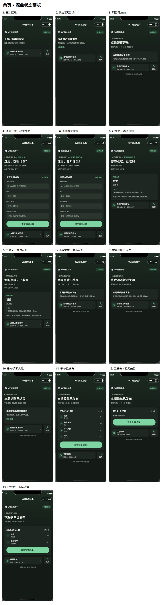
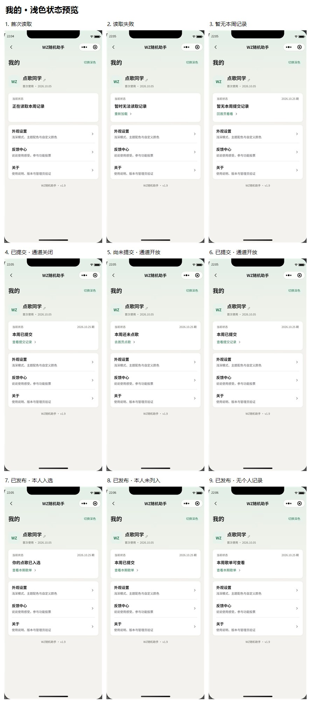
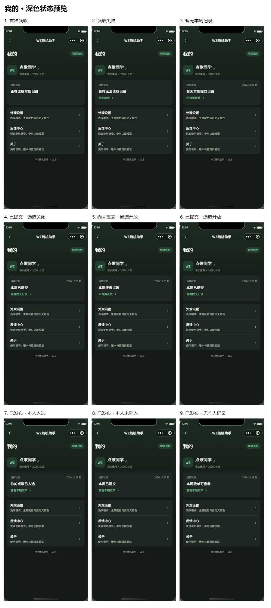

# 普通用户与管理员界面：本轮调整与状态截图

2026-10-27（美国东部时间）。改动前备份：565700b，已推送。

## 调整结果

- 我的本周卡片保留期次、一句个人记录摘要和一个入口，不再重复首页的通道规则、开放时间及大段说明。加载期间保留同一容器；本轮不改变周期、缓存、静默刷新或入选判定。
- 整个名称区域可点击修改，编辑图标缩为22rpx，放在名称右下方；称呼仍为居中弹窗。首次日期继续读取真实created_at。
- 自定义颜色使用轻微主题底色、细边线及“已选”，展开/收起不改变当前选择。外观仍即时保存。我的与反馈中心去掉标题下的介绍语，反馈提交区去掉底部小字，服务端频控保持不变。
- 使用反馈/功能投票等宽。文字平滑换色、滑条320ms移动、内容淡入；支持单指横滑，忽略纵滚、左缘系统返回、多指、输入中和忙碌状态。
- 我的反馈独立为二级页面pages/feedback/history，保留分页、重试、处理状态、版本化已读确认与详情回复。详情抽屉按内容高度展开。
- 投票进行中使用带圆点的主题色徽章。只有选项外框圆角；比例填充的末端是直边，外框高于填充，选中勾位于独立前景位置，文字不被覆盖。
- 普通用户子页面、管理主页面与普通管理员能用到的控制台/验证页均有返回箭头；直接进入时有所属上级页作为回退。首页是根页面。管理后台改为与普通用户页相同的测量式自定义导航，状态栏/胶囊仍由系统和微信绘制；渐变从同一顶部起始。
- 去掉前台测试横幅。保留管理后台已有“测试模式”标记，测试/正式数据隔离、白名单和权限原样保留。
- 通知从“安全区顶部”改为“导航区下方12px”，短文自然宽度、长文换行。成功/提示图标使用SVG，避免CSS勾形变。
- 普通页面输入使用原生键盘避让及24px光标留白；固定弹窗/抽屉按实际键盘重叠量上移。监听同时处理安卓先缩窗后报键盘高度的顺序，不重复抬升。卸载解除监听。
- 抽屉去掉固定52vh内容区与86vh高度，按内容与实际可用窗口限制；长内容独立滚动、隐藏滚动条，保留背景滚动锁定、顶部下拉、遮罩关闭和300ms下移退场。底部安全区保留，因此iOS与安卓安全留白可以不同，正文采用同一布局规则。

## 验证范围与边界

本轮全局检查覆盖普通用户及普通管理员可接触的页面，不重新设计超管专用编辑器。共享组件的修正会被其它页面复用。

132项测试通过，包括手势排除、分页、回复版本、键盘覆盖/窗口缩高/事件顺序及导航回退；官方21份WXML、26份WXSS编译通过。前端源码108文件、587931字节（574.2KiB），低于1500000字节预算；Progress截图/文档已被packOptions排除，发布前仍需检查实际编译包。

微信开发者工具内确认姓名区域打开弹窗、历史列表打开详情、横滑切换、返回箭头、投票外框、长短通知及抽屉下拉退场；模拟300px键盘覆盖时，验证码输入框底部383px，处于544px可见区域内。控制台error过滤无命中。iOS/安卓真机、第三方输入法、小屏长文本仍需实际设备复核，模拟器与布局测试不能代替真机结论。

未修改、部署云函数，未上传或发布小程序。本轮使用已部署接口；1.8服务端逻辑不变。

## 截图口径

以下44张是实际小程序WXML/WXSS在开发者工具模拟器中的截图，13种首页状态、9种我的状态，每种浅/深各一张。为覆盖失败与边界情况，临时注入了**仅页面展示数据**，示例歌名与期次不写云端；不是伪造线上业务结果。截图后重建页面恢复正常读取，未通过状态截图修改外观偏好、角色、投稿、歌单或投票。补充图使用既有测试反馈或页内提示样例，不含正式用户反馈。

完整展示数据生成源：[qa-public-states.cjs](../qa-public-states.cjs)。业务日期按中国时区，截图设备时钟为模拟器当时显示，两者含义不同。

## 首页状态

| 状态 | 浅色原图 | 深色原图 |
| --- | --- | --- |
| 首次读取 | [查看](screenshots/20261027-public/home-light-loading.jpg) | [查看](screenshots/20261027-public/home-dark-loading.jpg) |
| 状态读取失败 | [查看](screenshots/20261027-public/home-light-error.jpg) | [查看](screenshots/20261027-public/home-dark-error.jpg) |
| 周日开放前 | [查看](screenshots/20261027-public/home-light-before-open.jpg) | [查看](screenshots/20261027-public/home-dark-before-open.jpg) |
| 通道开放・尚未提交 | [查看](screenshots/20261027-public/home-light-open.jpg) | [查看](screenshots/20261027-public/home-dark-open.jpg) |
| 管理员临时开放 | [查看](screenshots/20261027-public/home-light-temporary-open.jpg) | [查看](screenshots/20261027-public/home-dark-temporary-open.jpg) |
| 已提交・通道开放 | [查看](screenshots/20261027-public/home-light-submitted-open.jpg) | [查看](screenshots/20261027-public/home-dark-submitted-open.jpg) |
| 已提交・等待发布 | [查看](screenshots/20261027-public/home-light-submitted-closed.jpg) | [查看](screenshots/20261027-public/home-dark-submitted-closed.jpg) |
| 本周结束・尚未发布 | [查看](screenshots/20261027-public/home-light-closed.jpg) | [查看](screenshots/20261027-public/home-dark-closed.jpg) |
| 管理员临时关闭 | [查看](screenshots/20261027-public/home-light-force-closed.jpg) | [查看](screenshots/20261027-public/home-dark-force-closed.jpg) |
| 歌单读取失败 | [查看](screenshots/20261027-public/home-light-schedule-error.jpg) | [查看](screenshots/20261027-public/home-dark-schedule-error.jpg) |
| 歌单已发布 | [查看](screenshots/20261027-public/home-light-published.jpg) | [查看](screenshots/20261027-public/home-dark-published.jpg) |
| 已发布・暂无曲目 | [查看](screenshots/20261027-public/home-light-published-empty.jpg) | [查看](screenshots/20261027-public/home-dark-published-empty.jpg) |
| 已发布・不足四首 | [查看](screenshots/20261027-public/home-light-published-short.jpg) | [查看](screenshots/20261027-public/home-dark-published-short.jpg) |

## 我的状态

已提交的开放/关闭状态保留相同简短个人摘要，不再重复首页通道文案。发布后，仅submission_id确实匹配本人投稿才能显示入选；没有记录不能断言从未投稿。

| 状态 | 浅色原图 | 深色原图 |
| --- | --- | --- |
| 首次读取 | [查看](screenshots/20261027-public/my-light-loading.jpg) | [查看](screenshots/20261027-public/my-dark-loading.jpg) |
| 读取失败 | [查看](screenshots/20261027-public/my-light-error.jpg) | [查看](screenshots/20261027-public/my-dark-error.jpg) |
| 暂无本周记录 | [查看](screenshots/20261027-public/my-light-closed.jpg) | [查看](screenshots/20261027-public/my-dark-closed.jpg) |
| 已提交・通道关闭 | [查看](screenshots/20261027-public/my-light-submitted-closed.jpg) | [查看](screenshots/20261027-public/my-dark-submitted-closed.jpg) |
| 尚未提交・通道开放 | [查看](screenshots/20261027-public/my-light-open.jpg) | [查看](screenshots/20261027-public/my-dark-open.jpg) |
| 已提交・通道开放 | [查看](screenshots/20261027-public/my-light-submitted-open.jpg) | [查看](screenshots/20261027-public/my-dark-submitted-open.jpg) |
| 已发布・本人入选 | [查看](screenshots/20261027-public/my-light-published-included.jpg) | [查看](screenshots/20261027-public/my-dark-published-included.jpg) |
| 已发布・本人未列入 | [查看](screenshots/20261027-public/my-light-published-other.jpg) | [查看](screenshots/20261027-public/my-dark-published-other.jpg) |
| 已发布・无个人记录 | [查看](screenshots/20261027-public/my-light-published-no-record.jpg) | [查看](screenshots/20261027-public/my-dark-published-no-record.jpg) |

## 其它交互截图

| 内容 | 截图 |
| --- | --- |
| 名称区域点击后的居中弹窗 | [查看](screenshots/20261027-public/alias-dialog.jpg) |
| 独立反馈历史列表 | [查看](screenshots/20261027-public/history-list.jpg) |
| 内容高度的反馈详情抽屉 | [查看](screenshots/20261027-public/history-detail.jpg) |
| 自定义颜色已选提示 | [查看](screenshots/20261027-public/custom-selected.jpg) |
| 进行中/已结束、直边占比与选中前景 | [查看](screenshots/20261027-public/polls-status.jpg) |
| 导航下方短通知 | [查看](screenshots/20261027-public/message-success.jpg) |
| 导航下方长通知换行 | [查看](screenshots/20261027-public/message-long.jpg) |
| 管理后台沉浸导航与测试模式标记 | [查看](screenshots/20261027-public/admin-navigation.jpg) |
