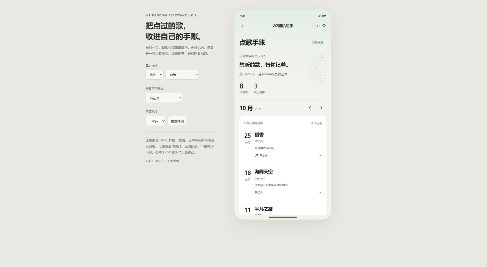
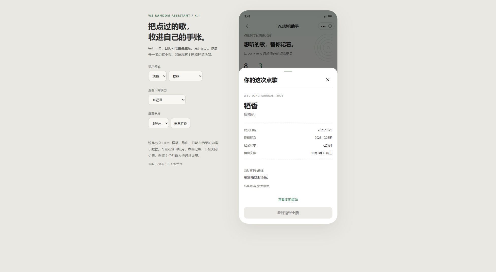
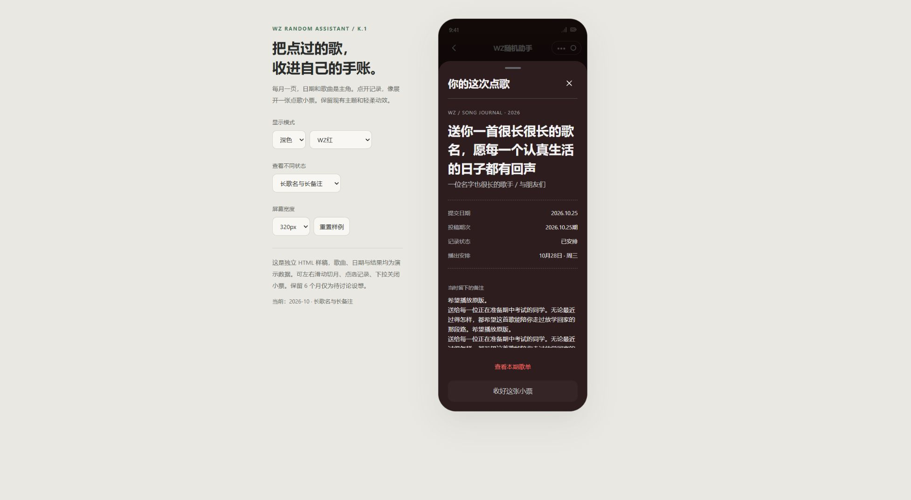

# 点歌手账 K.1 样稿与收歌规则讨论

日期：2026-10-31，美国东部时间。业务开放时间均按北京时间。

修改前备份 `e6d4036` 已推送。本轮只创建独立预览和同步讨论记录，未改正式页面、开放规则、验证码、候选上限或云函数；未新增集合或部署。以下均为待用户确认方案。

## 手账样稿

[打开独立 HTML](mockups/K-song-journal.html)。可直接用浏览器打开，无外部字体、图片、脚本或业务请求；本轮浏览器预览地址为 http://127.0.0.1:4178/ （依赖本机临时预览服务）。

- 上半部为用户自己的摘要与轻量唱片纹线；下半部每月共用一个纸面，日期、歌名、歌手和状态形成连续排版，不为每次投稿再加独立大卡片。
- 月份箭头与横向手势按新旧顺序切换，两端停止；短暂淡入。小票详情保留清晰标题、投稿时间、期次、已确认安排和完整备注；长内容独立滚动，顶部与关闭按钮固定，遮罩、Escape、顶部下拉关闭。
- 已安排、已提交、结果暂不可确认分别展示；历史缺失不能推定未入选。对应歌单已不在可查看范围时不显示跳转按钮。
- 包含有记录、首次空白、月份空白、加载、读取失败与长文本状态；320/390/430px、浅深色和松绿/晴蓝/烟紫/WZ红/固定自定义红示例。预览内嵌当前主题生成的颜色数据，自定义项只展示一套固定示例。
- 所有曲目、时间和结果均为虚构演示；6个月保留、统计范围与文案尚待确认。返回“我的”为局部入口演示；跳首页和已发布歌单仅提示目标，不访问业务接口。

## 开放时间建议

拟从周五20:00开放到周日20:00，共48小时。保持周日关闭后再抽取，周五/周六投稿归入即将到来的周日的week_key；已发布列表则仍可能属于上个周日，不能把两者混作同一期。首次使用、本周投稿、首页下次开放提示、管理员通道、说明及缓存都需同步。

源码当前默认仅周日8:00–20:00，服务端在checkWeeklyCode再次判定；按文档验证码周五2:00生成，但线上定时器实际配置仍须部署前核对。自动生成可用代码不等于已完成对学生的分发。手动强制开/关继续拥有原优先级。

## 校内准入建议

建议首次成功验证后保存有到期时间的学期准入，平时每周提交免重复输入；学期轮换时重新验证。新访问者首投前只做一次，浏览歌单不新增阻碍。准入字段单独保存，绝不复用管理员role或管理员通行码。

共享口令只是“拿到校内分发口令”的筛选，不能严格证明在校身份，存在转发风险。轮换、错误尝试限流、冻结/撤销能力和后台到期检查仍需设计。强身份确认需学校现有账号、校邮或人工邀请渠道；不默认索取姓名、学号、班级或证件照片。旧版1.8继续提交周验证码的兼容路径需专门验证。沿用每周一次投稿，重复填写本周码的本地记忆无法解决每周都要找码的问题。

## 候选容量与估算

用户口述过去12小时约100首；按时间线性放大48小时得到400首，仅为情景估算。固定学生群体、延迟补投、宣传曝光和重复投稿会改变到达曲线，300首可以作为准备情景，不能推定下限。后续应查看至少2–4轮逐日/分时有效提交、独立用户和被拒原因的汇总，不记录额外身份信息。

当前不是“最多存250条”：前250条pending参与候选，后续overflow仍显示成功并计数，但不抽取/替补，发布后清理。拟在扩窗时一起调整，建议按预期300–400首、候选保护阈值1000条准备，所有已接受候选仍参加原随机/判重/优先级流程，达到阈值明确拒绝或暂停并告知；该数字是容量建议，须实测后确认。日播出最多4首、每周最多20首不因此变动。

不能只改一个250常量：checkWeeklyCode同时存在旧文档兼容扫描limit(250)，抽取/替补分页、事务并发、审核查询、清理、计数和个人历史归档均需核对。达到保护阈值后不应伪装投稿成功。数据量增加可能影响调用次数、延迟与费用，上线前用测试域验证，不凭数字承诺性能。

## 本轮验证边界

内联脚本语法检查通过；浏览器检查月份箭头与边界、记录小票、Escape/按钮关闭、无记录月份、320px深色长备注。触屏左右滑动与顶部拖动已实现，但本轮未做手机真机触摸验收。正式小程序源码与后端均未改。

