# 点歌记录接入与界面细化

日期：2026-11-01，美国东部时间。业务时间仍按北京时间。开工备份 `f12b954` 已推送；本轮前端未上传或发布。

## 页面安排

我的保留“点歌记录、外观设置、关于”三个入口，反馈中心归入关于，关于原使用说明、管理员验证和隐私入口保持。“点歌记录”沿用原likes路由以兼容已有链接，页内分“我点过的/我喜欢的”，等宽标签、指示条及320ms内容淡入，左右手势切标签；月份由同路径旋转的左右箭头切换，两端停止。

喜欢按北京时间自然日归组，只显示一次日期，同日默认两首，其余在当日展开/收起。分页追加后仍归入同一日期。展开采用高度与透明度过渡，收起/抽屉退出保留动画，减少动画偏好可降级。详情只称“歌曲详情/点歌详情”，不用“小票”等需要猜测的名词，去掉总数旁“当前”；截止后仍明确最终数。取消喜欢缩成危险色文字，与“关闭”和“查看这期歌单”分层，二次确认后才写入。

记录页原标语全部删除；我的、记录和反馈没有副标题时，标题下留白缩至24rpx。用户否决浅色卡片着色，本轮已完整回滚该尝试，内容面保持白色；仅将浅色页面渐变起点/中间的主题混合加强，沿用180px中间点和420px自然淡出。辅助文字按更强渐变重新校核4.5:1对比度。深色主题颜色不变。

记录、关于和反馈试用右上主题图标。装饰用SVG显式设置512×512解码尺寸，避免大尺寸image的低分辨率解码；主体不加模糊，边缘另用低透明柔化层渐隐，部分出屏，位于内容下方且不接受点击。没有引入图标库、位图或全屏滤镜。

## 个人历史与1.8兼容

本轮复用现有私有本人投稿 `submissions`，不新建历史集合，不在users中累加数组。投稿原文、歌手、备注、原周次和提交时间保存六个月（按原期次起算），包括overflow；`drawWeeklyPlaylist` 只删除六个月到期投稿，`adminAuditPlaylist` 发布后不再删除overflow。原投稿唯一索引、提交接口、验证码、开放时间、250候选上限不变。

保存期与候补资格分开：仍只抽本周pending及前两周carryover，判重仍查前两期，overflow仍不参与抽取/替补。未发布排期仍按原三周清理。旧1.8读取本周投稿及既有请求参数不变，新增月份接口不要求旧客户端调用；本轮没有修改checkWeeklyCode。没有执行正式抽取或正式数据试写。

`manageSongLikes.listSubmissions` 取实际登录身份，按本人、北京时间提交月份分页，每页20条；关联原期次及后两期的正式已发布歌单，仅submission_id精确对应才显示入选及实际安排。待审核/已抽取不提前宣称已入选；没有匹配时保守显示等待结果/未见入选记录，overflow明确未进入候选。返回字段白名单不含本人或他人身份。

已经清理的投稿不能恢复，新保存期只能保住目前尚存和之后产生的数据。界面不承诺完整半年，也不把缺失历史写成从未点歌。管理员已有人工删除/维护能力保留，不能承诺人为删除后的记录永久存在。

## 追加的对齐与长列表修正

审核页原page背景渐变可能在长画布重复，现设顶部100%×420px单次绘制、不重复，下方用bg接续；原生真实20首审核列表滚至1500px核对，不操作审核或发布。关于/反馈内容与页脚建立明确的前景层，装饰层固定在0层，避免绝对定位图标盖到普通流卡片上。

我的头像从92rpx适度增至112rpx，名称行最小高度缩至64rpx、两行行高收紧，让文字视觉范围落在圆角头像内。头像独立使用avatar-surface/on-avatar，浅深及各主题对比度校核，不给其它白卡着色。头像/卡片层级截图补在文末。顺便将点赞和色盘组件的标签/属性样式选择器改为类名，避免组件WXSS限制导致规则失效。

## 云端与验证

用户已确认部署：manageSongLikes完整更新（六文件），drawWeeklyPlaylist完整更新（五文件），adminAuditPlaylist仅index.js增量更新。三函数均Active、Nodejs16.13，超时分别3/60/60秒。源码下载逐文件回读一致，admin原线上依赖/config保留；回滚副本在本机.cache/journal-before，Git基线f12b954。部署哈希见[证据](../deployments/2026-11-01-song-journal.json)。

submissions及test_submissions各新增user_history_month_v1（user_id、submit_time降序、_id降序），已回读核对，原user_id+week_key唯一索引保留。首次索引请求传错参数、工具拒绝未生效；更正为updateCollection/update-options-file后已确认完成，没有删除原索引或改投稿数据。

155项回归通过，覆盖身份/测试域隔离、只关联正式结果、超期不可见、overflow可查询、候补不延长、同日分组与分页合并、切标签迟到响应保护、取消确认前不写入及既有1.8业务回归。官方23份WXML/28份WXSS编译通过，源码预算仍低于1.5MB，精确值见部署证据；实际编译包仍需发布前由开发者工具核验。

原生模拟器真实历史查询成功（当前测试账号本人投稿为空），喜欢列表/详情/取消确认已检查；只打开确认未执行取消，原赞数保持。四首同日折叠使用仅setData的“布局示例”，不可互动、不写云端，检查完完整刷新已清除。图标曾被热重载的旧主题模块缓存，完整编译后核实Decor来源存在。下方浅色截图为清晰主体检查，深色截图为随后最终渐隐检查；分组样例只验证折叠布局。普通账号iOS/安卓真实手势、旧1.8手机端到端及小屏仍需验收，不把模拟器截图等同双端真机通过。

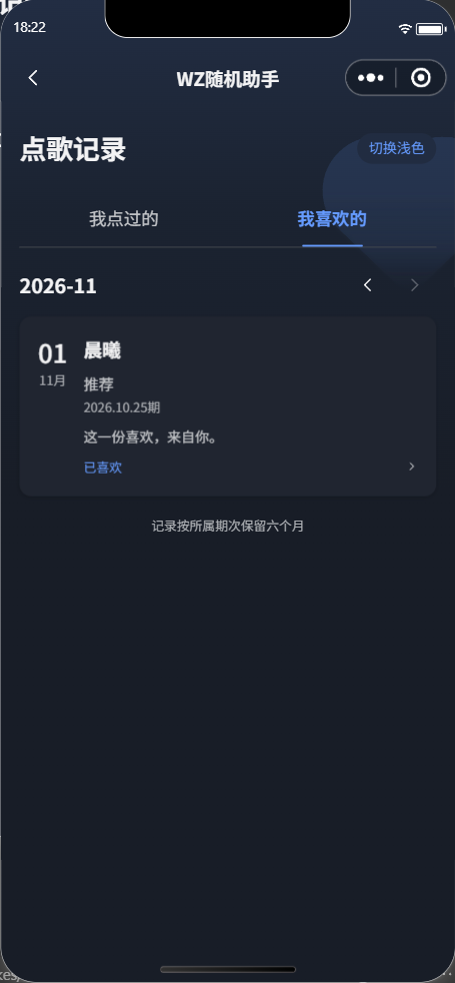

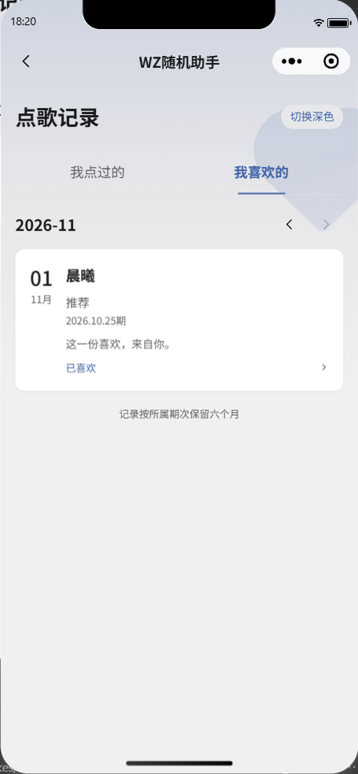

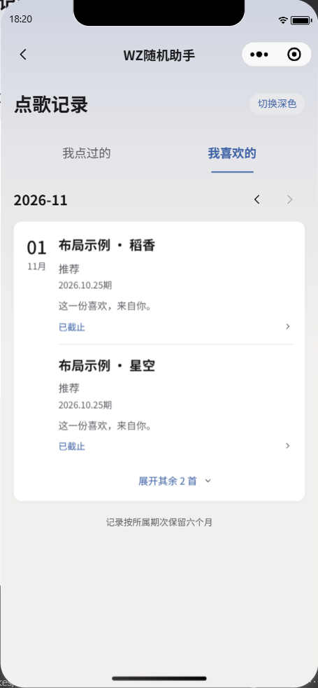

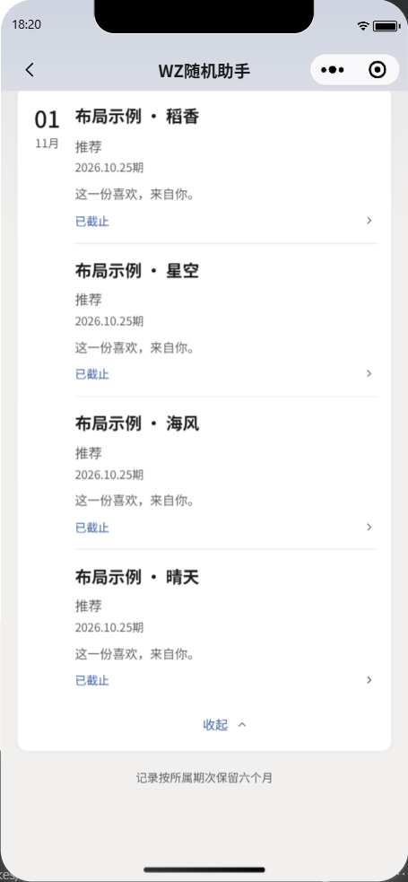

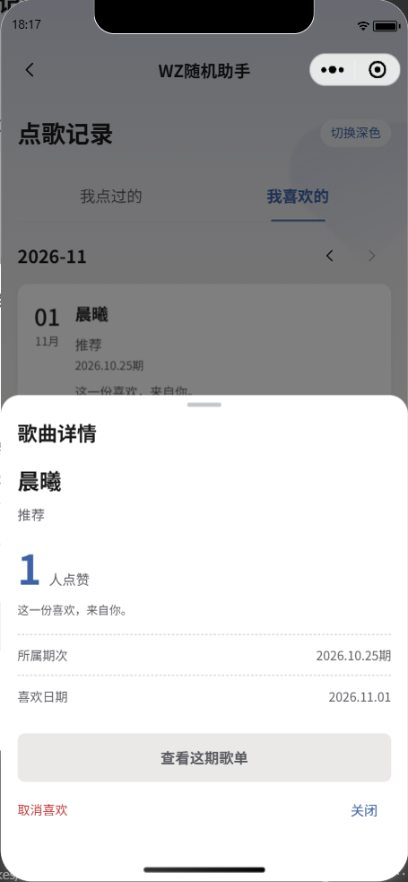

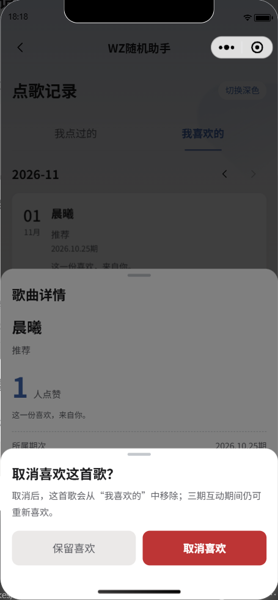

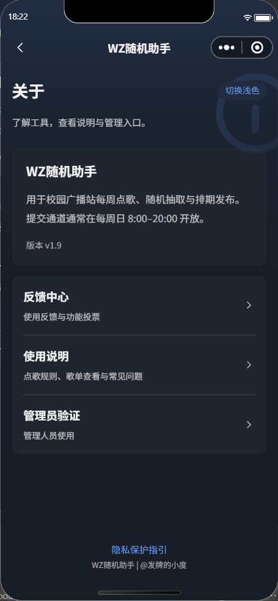

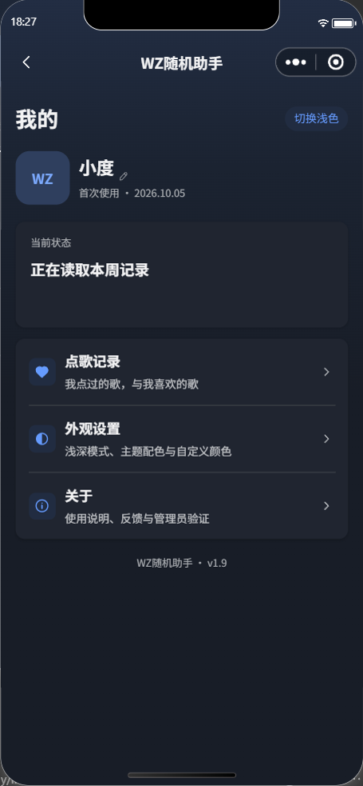

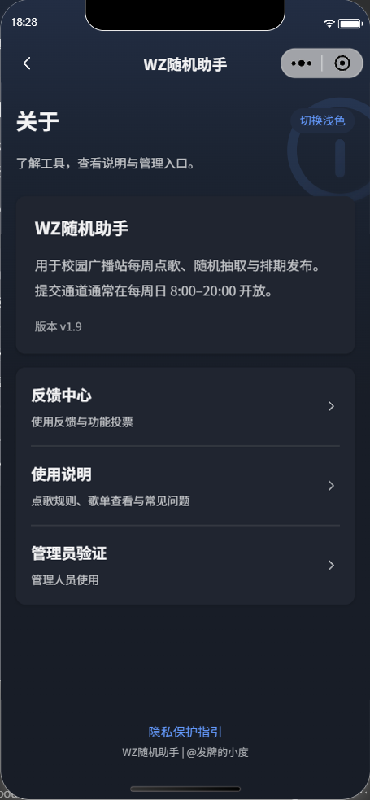

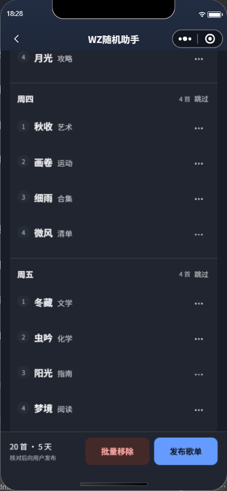

## 后续图标调整

备份cc2c0a8后按参考图手绘双音符，首页我的补同规格主题背景面。调色盘方案被用户否决，外观入口恢复原半明半暗图标，抽屉装饰同步恢复；我的页增加右上人物轮廓装饰，头像WZ字体改36rpx。155项回归及23WXML/28WXSS官方编译通过，无后端修改或前端上传，原生模拟器检查如下。

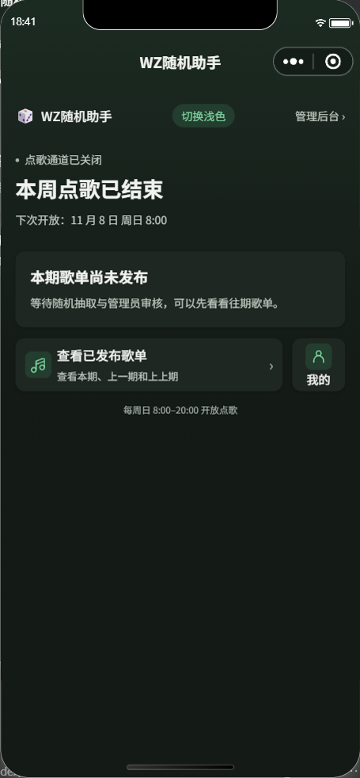

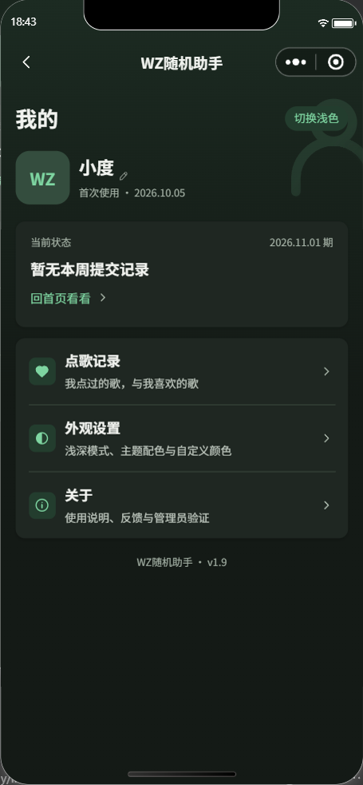

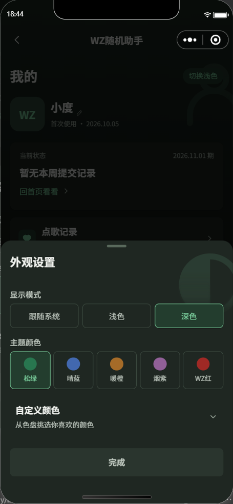

### 本轮最终状态：统一装饰与移除临时按钮

全14页的临时浅深切换按钮、组件注册及四个组件文件删除，显示模式统一由我的→外观设置调整，仍保留跟随系统/浅/深、跨页实时同步和保存。正式后台隐藏空的meta区域，测试模式标记保留。155项回归通过，官方编译现为22WXML/27WXSS，源码预算低于1.5MB；本轮无云函数改动或上传发布。

我的/点歌记录/关于/反馈共用page-ornament容器，350rpx正方形、右侧出屏100rpx、导航高度+8rpx。原生模拟器测量我的与关于均为left260.4/top91/width182/height182 CSS像素（当前视窗），两层边界一致；不同页面不再单独写尺寸。抽屉装饰继续按抽屉顶部定位。下方是去掉临时按钮后的最终画面，上方旧截图保留本轮调整过程。

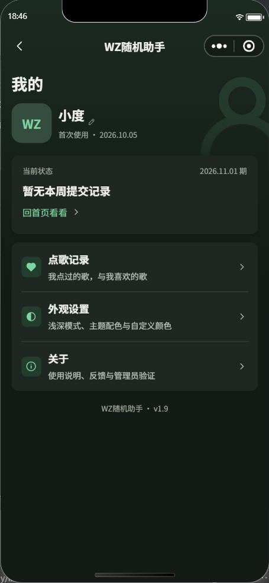

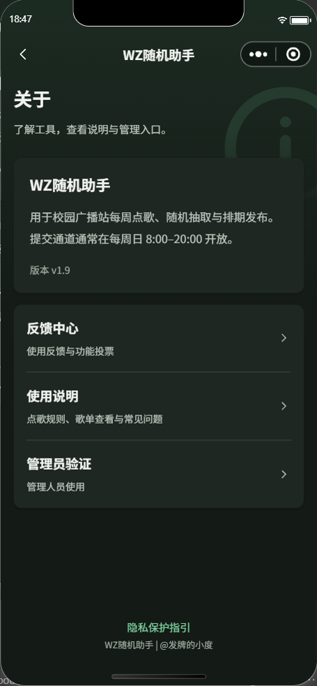
