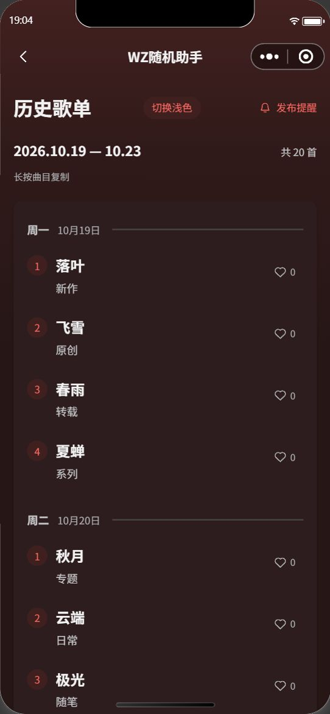
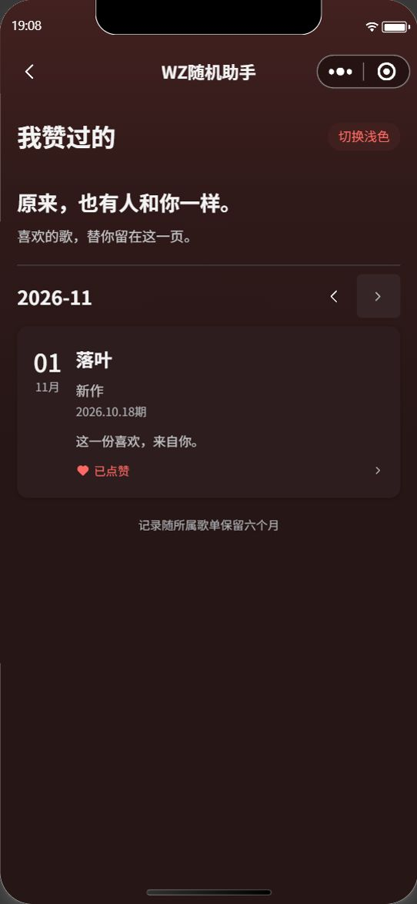
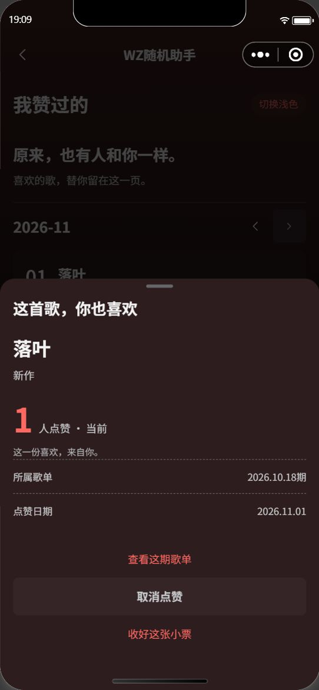

# 点赞与“我赞过的”接入验收

日期：2026-10-31（美国东部时间；截图业务日期为北京时间11月1日）。开工前备份 `5e31ce2` 已推送。用户授权正式接入，前端仍未上传或发布。

## 当前行为

- 歌单每首右侧有主题矢量爱心及数量。一人可赞多首，每首一份有效赞，可取消；点击先更新，失败还原并明确提示，刷新后再重试。
- 互动范围与现有三期标签一致：北京时间当前最近周日及前两个周日对应的已发布歌单。更早歌单只读最终数量；未发布、撤回、过期、曲目替换均由服务端拒绝写入。无歧义的旧曲目无需迁移即可使用，无法区分的重复旧曲目不允许误写。
- 我的增加“我赞过的”，按点赞月份翻阅连续手账，每次20条；详情展示歌曲、歌手、当前或最终总数、所属期次、本人点赞日期，可返回所属历史歌单。取消后从本人历史移除。返回列表和下拉刷新会校准数量，不做持续轮询，不承诺多人实时推送。
- 历史详情仅一个总数，不保存“我点赞时有多少人”的快照。“还有N人”是当前/最终总数扣除本人有效赞，不显示他人身份。
- 歌单按期次北京时间零点起保留六个自然月，月末按目标月最后一天钳制。点赞关系使用相同到期时间，不随重新点赞/重新发布续期；接口到期立即隐藏，周抽取任务负责物理清理。过去已被清理的数据不能恢复。
- 本轮不做未上榜/overflow投稿的个人历史，不改开放时间、250候选上限、准入方式或原骰子。

## 数据与同步

`schedules.like_counts_v1` 保存稳定曲目标识到总数的映射；新增私有 `song_likes` 与 `test_song_likes` 保存本人关系。曲目标识由所属歌单、原投稿标识和曲目内容推导；无投稿标识时使用内容兼容。换序、改备注不变，换歌/歌手重新生成，不让新曲目继承旧赞。

关系的确定性ID按本人、歌单、曲目标识生成，包含 `active`、`version`、数值 `liked_at`、`expires_at`。取消保留无效记录和版本直到到期，避免迟到请求覆盖后来的选择；个人列表只返回有效记录。`setLike` 使用目标状态及版本，汇总与本人关系在同一事务更新，重复目标请求幂等；冲突/网络失败会提示刷新，不自动重放相反操作。

前端同一歌单共用整期读取、请求去重和短时缓存，不为每首单独查询。写入期间不让旧读取覆盖乐观显示。本人历史按本人/月份分页，再批量关联歌单。云函数取实际登录身份，不接受客户端传入的用户身份；测试域沿用原白名单，正式/测试隔离。

两个集合均已创建，各有以下三个新增索引并已回读核对；真实客户端直读均被拒绝：

| 索引 | 字段 | 用途 |
| --- | --- | --- |
| owner_schedule_v1 | owner、schedule_id | 整期本人状态 |
| owner_month_v1 | owner、active、liked_at降序、_id降序 | 月份历史分页 |
| expires_v1 | expires_at | 清理到期记录 |

## 1.8兼容与部署

- 新增 `manageSongLikes` 已部署，Nodejs16.13、3秒、Active，五个源文件下载后与本地一致。其它旧函数无需调用新服务。
- `drawWeeklyPlaylist` 已获开发者工具确认部署，Nodejs16.13、60秒、Active。修改仅为已发布歌单保留六个月、清理到期点赞；未发布排期/投稿仍按原三周、订阅仍按原两周清理。候补仅前两周、历史重复判定仅前两期，原抽取和1.8参数不变。
- 部署前下载的线上抽取index与备份5e31ce2一致；部署后六个源码/配置文件与本地一致。dataScope、config和依赖版本不变；完整部署带上仓库原有MIT许可证元数据（旧线上为ISC），不改变运行依赖。
- 点赞只局部更新独立汇总字段，不改day1–day5、原响应结构或管理员revision；没有对正式业务数据试写，也没有手动调用正式抽取。
- 代码备份可从Git恢复，部署前线上副本保存在本机 `.cache/likes-deploy-before/drawWeeklyPlaylist`，未把云端依赖目录提交到仓库。逐文件哈希见[部署证据](../deployments/2026-10-31-song-likes.json)。

## 已做验证与边界

150项自动化全部通过，包含一人多首、取消/重试、事务竞争、迟到版本、身份/测试域隔离、曲目重排/替换/撤回、北京时间周日切换、六个月到期与清理分离，以及既有1.8提交/抽取/审核等回归。官方编译23份WXML、28份WXSS通过；118个前端源文件620636字节（606.1KiB），预算低于1.5MB，发布前仍以开发者工具实际编译包为准。

测试域真实调用已验证整期读取、赞数0→1、本人历史与详情展示；在详情实际点击取消后1→0，个人列表变空，测试数量已恢复。下面截图取自原生模拟器及真实测试域，不是HTML样例。点赞集合中取消后的版本记录按设计保留。

自动化点击歌单自定义组件宿主未触发内部按钮，不能把该步骤记作爱心UI点击已验；新增点赞的真实云端请求及详情取消UI已验。尚未在正在使用的1.8手机客户端做完整端到端测试，兼容结论基于代码对照、回归及独立服务设计；普通账号iOS/安卓的爱心点击、手势/长按、弱网、冻结状态、小屏抽屉和最终编译体积仍需发布前真机复核。

