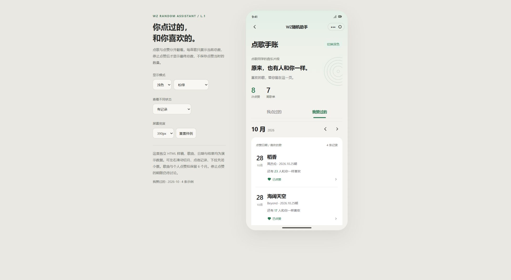
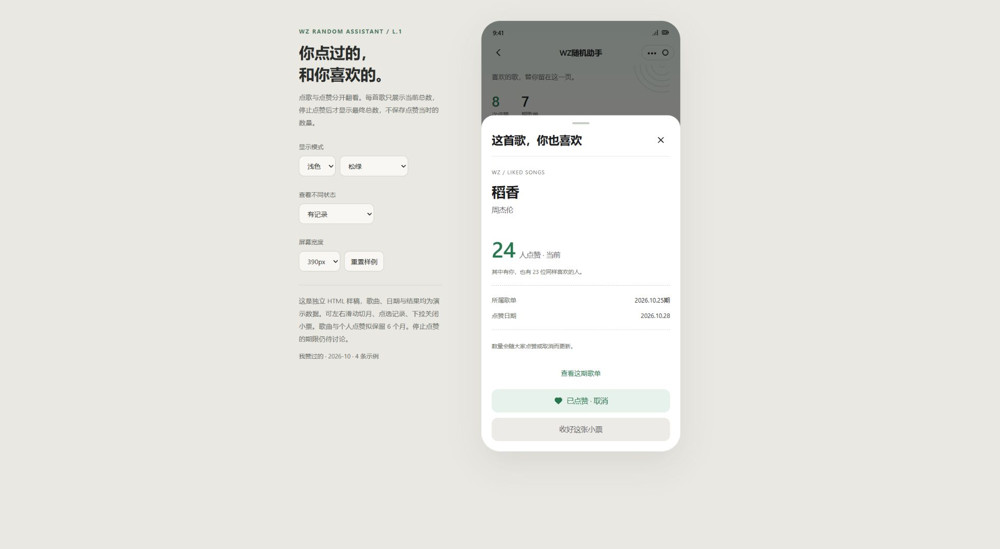
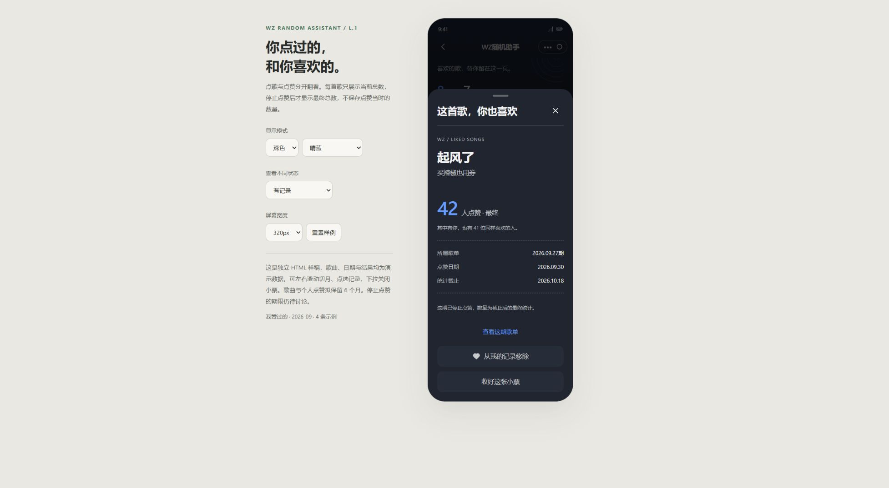

# 我赞过的 L.1 预览与歌单复用方案

日期：2026-10-31（美国东部时间）。开工备份 `6a2a4bb` 已推送。本轮仅预览、截图和文档，正式页面、云函数、集合和清理任务均未改、未部署。

> 后续更新：用户随后确认仅三期互动，并授权实际接入；本文件保留预览时的讨论，当前实现、六个月起算点和部署结果以[点赞接入与1.8兼容验收](点赞接入与1.8兼容验收-20261031.md)为准。截止后不提供取消/移出记录，旧样例不代表正式功能。

## 最新约束与样稿

用户明确：一人可赞多首，同一期同一曲目每人最多一个有效赞且可取消；详情只显示当前/最终总数，不保存点赞当时的人数。开放时间再议，250候选上限有意保留不动。

[打开 L.1 HTML](mockups/L-liked-journal.html)。本机临时预览：http://127.0.0.1:4179/ 。演示数据全部内置，不访问业务接口。

手账增加“我点过的/我赞过的”标签，按点赞月份翻页，同一期可以出现多首本人点赞的歌。列表显示“还有N人和你一样喜欢”，N为总数减本人有效赞；只有一人时不推断谁最早点赞，避免其他人取消后误称第一位。详情只展示当前或截止后的一个最终总数，另有期次和本人点赞日期。

开放样例可以取消，个人记录会消失；已停止样例演示移出个人记录而不改最终数。重置按钮恢复全部内存数据。保留空/加载/失败/长文本、浅深色、320/390/430px检查入口。9月截止样例仅为评审最终状态，截止期限和是否提供移出历史功能仍待确认，不代表已确定三周封存。

## 数据建议

复用`schedules`中保留6个月的已发布歌单，保存曲目、期次及按稳定曲目标识映射的总赞数，无需另外复制一份曲目信息/总数快照。计数字段放在歌单级独立映射，避免管理员覆盖day1–day5数组时丢数；点赞不改变管理员编辑用revision。调整顺序保留标识，替换成另一首必须使用新标识，同歌跨期分别统计。

仍需要独立`song_likes`及test_集合，记录本人、歌单曲目标识、有效状态和同步版本。仅凭总数不能判断本人是否赞过、不能支持取消和查询个人历史；不在公开歌单中存点赞人的OPENID数组。个人列表按本人分页查关系，再批量读取相关歌单，避免每首单独请求。

云函数以真实用户身份执行，个人状态与总数在事务内同步；重复请求按目标状态幂等处理，旧操作不能覆盖新选择。撤回、替换、到期均须服务端再次判断。多人给同一期点赞会竞争歌单文档，需验证事务重试和延迟，不承诺绝无冲突。

## 六个月不等于只改一个清理常量

- 已发布歌单拟保留6个月，点赞关系随所属歌单统一过期；不能按每次点赞重新续存6个月。按期次还是发布时间计算具体到期仍需确认，重新发布不应无限延长。
- 投稿候补仍按前两周参与抽取；重复歌曲判断仍查前两期已发布歌单，不能随保存期扩成半年。未发布排期、原投稿、订阅的清理与长期歌单分开。
- 前台仍可默认三期标签，历史通过个人手账按期次打开；不必在原歌单页铺开半年标签。
- 互动期限待定。若6个月都允许点赞/取消，数量一直是当前总数；若提前停止互动，才有最终数，保留期限本身不能替代截止规则。
- 个人未上榜或overflow投稿不会出现在已发布歌单中，“我点过的”仍须独立个人历史归档。旧数据已清理就无法恢复半年记录。
- 公开接口仅返回曲目与汇总等必要信息，不公开投稿归属和点赞人身份；正式/测试隔离、旧1.8接口、管理员撤回/重发/清理均需回归。

## 检查

内联脚本语法通过；浏览器核对双标签、当前详情、取消移除与重置、月份切换、320px深色最终详情。触屏手势沿用K版实现，真机触摸未验。生产前端源码未改，源码包体积不增加。

