# 界面重构方案（v2.0 视觉与个性化）

> 本文档记录 2026-10 开始的界面大改：目标、参照、现状体检、设计规范、逐页改造清单与验收标准。
> 后续每次改动都把截图放进 `shots/`，在本文对应位置引用，形成完整的改造过程记录。
>
> 关联文档：`../广播站点歌小程序.md`（项目现状与待办）、`../历史-决策与专项验收.md`（历史决策）

> **当前方向（2026-10-26）**：首页三态、F.3歌单、G说明关于、连续渐变与导航已接入；九页浅深色与切换按钮本轮已实现，尚未上传发布。首页双入口及我的仍待讨论，图鉴、足迹、其它主题和背景未实现，E/B/C为历史探索。
> **已确认并接入代码**：[F.2 主卡片方案](mockups/F-playlist-card.html) 已由用户确认并接入 `pages/playlist`，首页与歌单共用整页连续渐变和自定义顶部导航。功能回归通过，未上传发布；HTML 的深色仍为预览。E.2 原样保留为历史对照。
> **F.3 收尾**：同一 F 文件与正式模板同步日期标题层级、无卡片加载/未发布/失败提示；已发布零曲目排期仍保留卡片。下一步先做说明与关于页预览，再继续深色基础。
> **说明/关于 G 版已接入**：[G版预览](mockups/G-info-pages.html) 保留；正式两页已接入浅深色和统一渐变/导航，底部隐私署名保留，模拟器已查看，普通账号真机待验收，未上传发布。
> **最新讨论（未实施）**：首页保留轻量「关于 · 我的」，说明归关于；建议先深色基础，再我的轻量版。说明十图云函数已部署并回读核验，前端仍待发布。

### 本轮细节收尾（2026-10-26，最终视觉待复核）

- 歌单左/右滑切三期，保留标签与边界；用户不希望左右晃动，最终正文采用320ms淡入。当前期次成功后静默预取另两期，保留缓存校验和撤回清理，只渲染当前一份内容。
- 首页歌单入口使用统一着色SVG；曲目按压高亮改公共中圆角，保持序号和正文对齐。说明正文撤去色块，用短横线区分标题，整行细线分隔条目；展开/收起使用高度与透明度过渡，已创建图片节点不销毁。
- 关于底部居中两行：“隐私保护指引”“WZ随机助手 | @发牌的小度”，短页靠近屏幕底部，长页随正文下移并保留安全区。
- 骰子固定原浅色面、绿色点数和橙色一点，外层20rpx圆角保持；用户指出原填充不足，先推送 `d59b108` 后再改封闭内芯。几何源 `../build-dice-core.cjs` 生成样式，不增加运行时图形库。新填充和动画仍待真机视觉确认。
- 23文件61项回归通过；截图/样稿/文档继续留存Git，但整个Progress目录排除出前端包。77个源文件约354KiB，上传前仍需核对实际编译体积小于1.5MB。Esc后未继续操作应用，没有新增冒充最终验收的截图，历史HTML不代表新增动画已验收。

### 歌单提示与标签收尾（2026-10-27）

- 工具区所有状态保留“左右滑动切换歌单”，仅有曲目时追加复制提示；标签文字320ms变色，共享滑条按实际标签位置与宽度过渡，窗口变化重测，测量失败保留静态指示。正文原320ms淡入、三期预取和缓存校验保留。
- 用户最新要求骰子先搁置，本轮未改。DeepSeek“我的”方案只评审讨论，原稿保留，建议见7.9；尚未接入我的、背景或新主题。
- 23文件64项回归和微信模板/样式编译通过；以下为模拟器测试域截图，有曲目/未发布两态已核对，不替代普通账号真机验收。

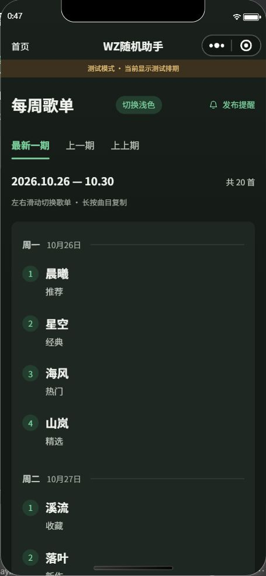
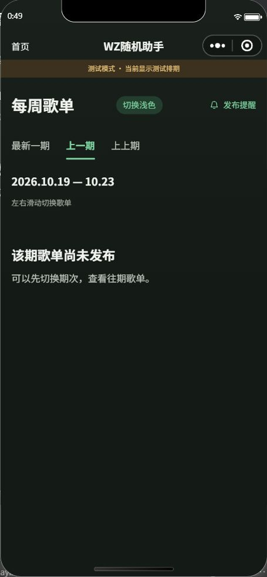

---

## 一、为什么改

当前界面能用，但存在三个结构性问题：

1. **没有视觉规范**。12 个样式文件里共有 **213 种颜色、28 种字号、15 种圆角、36 种间距**，同一个灰色有十来个版本，主色有三种绿/蓝并存。每新增一个页面就会多出一批新的散值。
2. **信息重点不突出**。首页第一屏是完整的表单；用户最想知道的「现在能不能点歌」只是一个 22rpx 的小徽章。
3. **已有内容没有被"看见"**。彩蛋里有 12 种文字猫 + 多张照片，界面只显示一个"3/12"的数字；已发布歌单是全站最常用的页面之一，却是最朴素的一页纯文字。

## 二、参照对象：倒带 App

参考：<https://rewind.uselessthing.top/>（官网仓库 [KusStar/rewind-docs](https://github.com/KusStar/rewind-docs)，MIT；APK 仓库 [KusStar/rewind-apks](https://github.com/KusStar/rewind-apks)）

素材来源：官网首页 showcase、[官方操作指南](https://rewind.uselessthing.top/tutorial) 内嵌截图（2020 年版本，设计语言与现版一致，具体页面可能已改版）。

### 2.1 播放页

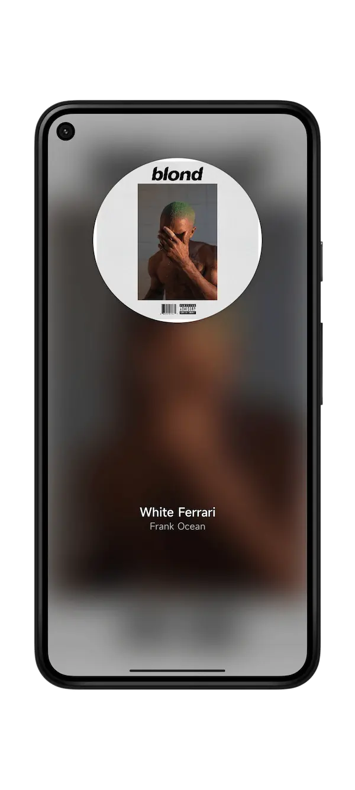

- 全屏专辑封面重度模糊作背景，形成"氛围色"；
- 中央圆形唱片（封面 + 白色圆形底），是全屏唯一视觉主体；
- 底部两行字：歌名（白、较大）+ 歌手（白、略小、稍透明）；
- 无卡片、无边框、无按钮、无进度条（进度条只在操作时出现）；
- 大量留白：唱片在上三分之一，文字在下三分之一，中间大片空白。

### 2.2 首页（歌单列表）

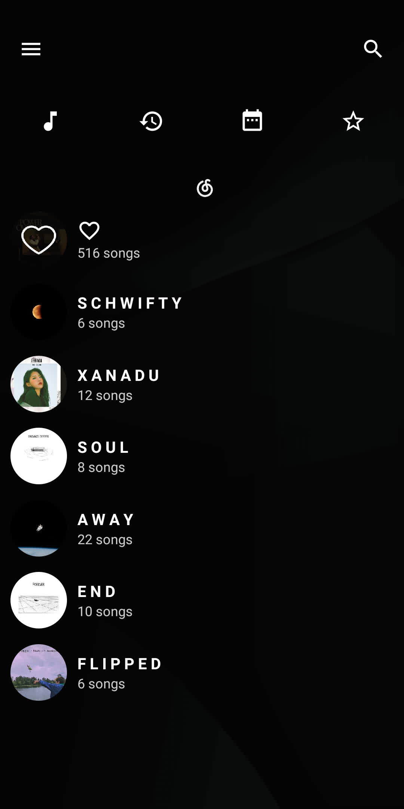

- 纯黑底色；左上汉堡菜单、右上搜索，均为细线条白色图标，无底色；
- 顶部一排功能图标（本地音乐、最近播放、每日推荐、收藏…），细线风格，等距排列；
- 歌单列表：**左侧圆形封面** + 右侧两行文字；
- 标题用**全大写 + 字距拉开**（letter-spacing 明显），副标题 `${n} songs` 用小字浅灰；
- 无分隔线、无卡片、无边框，行间距大（约 1.5 倍行高以上）。

### 2.3 登录页

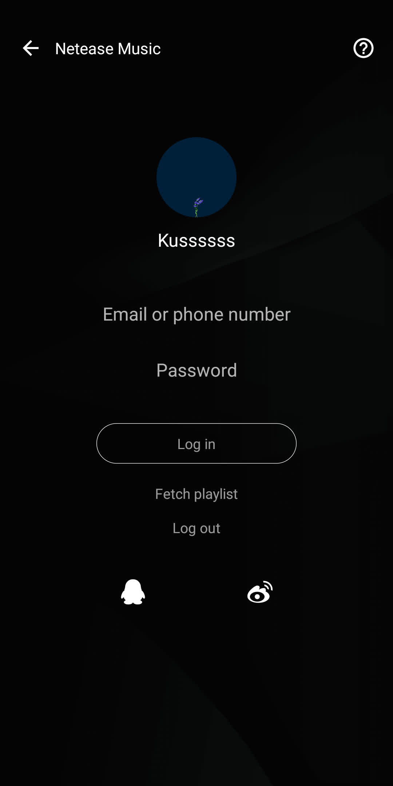

- 输入框**完全无框**：没有边框、没有底线、没有底色，只有灰色占位文字；
- 主按钮是**胶囊描边**（大圆角 + 1px 细描边 + 透明底 + 白字），不用填充色；
- 次级操作（获取歌单、退出登录）是**纯文字**，不用按钮；
- 顶部返回箭头、标题、帮助图标均为细线条。

### 2.4 它为什么好看

| 做法 | 有效的原理 |
| --- | --- |
| 全屏模糊封面作背景 | 界面颜色来自内容本身，永远和谐 |
| 屏幕只留一个主体（圆形唱片） | 注意力无处可逃 |
| 只有两行字：歌名 + 歌手 | 极简到没有一条多余信息 |
| 无卡片、无边框、无按钮底色 | 靠层级与留白分隔，不靠线条 |
| 圆形封面贯穿列表与播放页 | 同一个形状符号重复出现，形成识别度 |
| 全大写 + 加宽字距的标题 | 不用加粗加装饰也能拉开层次 |
| 黑白素雅 + 内容色点缀 | 彩色留给内容，界面本身不抢戏 |

### 2.5 手势与模式（官方操作指南）

- 播放页有**精简模式 / 详细模式**两种，向上滑切换；
- 单击歌名区域播放/暂停，左右滑切歌；
- 右滑打开详细列表，左滑打开当前播放列表，下滑缩小播放界面；
- 边缘上下滑动调进度/音量，移出边缘即撤销。

> 这套手势在小程序里大部分不可行（会与页面滚动、返回手势冲突），只借鉴"关键操作藏在手势里、界面不给按钮"的思路。

### 2.6 换肤 / 自定义背景（重点参考）

公开资料（多个下载站的换肤说明一致）：**左上角横杠 → 换肤 → 背景图 → 选择本地图片 → 裁剪 → 右上角勾 → 确认**。

推断实现要点：
- 背景图作用于播放页，盖在模糊封面之上（或替代它）；
- 选图后**必须裁剪**才能用——说明它按固定宽高比保存，避免不同比例导致布局错乱；
- 对比度问题靠"背景图 + 暗色遮罩"解决（黑底白字的天然优势）。

> 本项目的对应做法见 7.3：压缩 750px 宽、存本地文件、叠 60% 遮罩、限制 200KB。

### 2.7 关键差异（不能照搬的原因）

倒带约八成美感来自**专辑封面**这张有情绪的内容图。本项目的核心内容是纯文字歌单，直接套用「模糊背景」只会得到一块灰色模糊块。因此氛围来源必须替换（见 4.2「每周渐变」）。

另外，本项目是**浅色为主**（白天使用、校园场景），不照搬黑底；深色模式作为可选。

### 2.8 侧边栏与"低频功能收纳"（可直接借用）

官方教程确认：左上角汉堡按钮打开侧边抽屉，集中放置**换肤、定时、语言、背景**等低频功能；主内容区（歌单列表）不出现任何设置类按钮。

这条原则值得直接照搬：本项目首页目前把「管理后台」「说明」「关于」分散在页面各处，改造后可统一收进一个「我的」入口，主页面只留点歌相关动作。

### 2.9 动效与性能（来自官方更新日志的教训）

官方更新记录显示：3.2.0 将播放内核从 `MediaPlayer` 重构为 `ExoPlayer`，同版本加入「**禁用页面过渡动画**」开关；用户曾反馈"动画数量较多、速度偏慢"，这很可能是该开关的由来；3.2.2 做 Android 11 适配；歌手页改为**不可滚动的 Tab 结构**。

对本次改造的意义：**动效要克制、且可关闭**。本项目只做三类轻动效（按压反馈、卡片入场、数字变化），时长 150–220ms，并提供「减弱动效」开关照顾低端机。

### 2.10 闭源结论与素材边界

经全面检索（GitHub、Gitee、APKPure、AppBrain、逆向社区、应用商店）：

- **App 本体闭源**。公开的只有官网源码 [rewind-docs](https://github.com/KusStar/rewind-docs) 与 APK 仓库 [rewind-apks](https://github.com/KusStar/rewind-apks)（包名 `com.kuss.rewind`，v3.5.0，约 10.4MB）。
- 第三方评测（异次元软件世界）明确写明"应用免费，但并无开源"。
- 未找到客户端源码、反编译工程或技术拆解文章。

因此本文档的结论来自：官网截图、官方操作指南、公开评测、APK 分发元数据与公开更新日志——**不是**读源码得来的。凡属推断，文中均已标注。

### 2.11 已确认的页面类型清单

| 页面 | 可确认的结构特征 |
| --- | --- |
| 初始首页（未登录） | 内容区接近空白，只有登录入口 |
| 登录后歌单首页 | 列表 + 圆形封面，平台间滑动切换，大量留白 |
| 搜索页 / 搜索结果 | 入口在右上，结果纵向列表，无品牌色 |
| 在线歌单 / 本地歌单 | 标题 + 歌曲行，装饰极少 |
| 普通播放页 | 封面、歌名、歌手、控制按钮 |
| 全屏沉浸播放页 | 模糊封面背景 + 圆形唱片 + 两行白字，控件几乎全隐 |
| 歌词 / 评论页 | 纵向滚动歌词，独立页面而非覆盖播放页 |
| 侧边栏功能菜单 | 换肤、定时、语言、背景等低频设置 |
| 换肤 / 背景图设置页 | 选本地图片、调背景透明度 |
| 图片裁剪确认页 | 选图后裁剪，右上角对勾确认 |


---

## 三、现状体检（2026-10-26 实测）

扫描 12 个 `.wxss`，共约 58KB（`pages/admin/admin.wxss` 单文件 19.7KB 最大）。

| 项目 | 现状 | 主要问题 |
| --- | --- | --- |
| 颜色 | 213 种 | `#07c160`(34) / `#1976d2`(25) / `#2d8057` 三种主色并存；灰阶有 `#222 #333 #555 #666 #888 #999 #bbb #ccc #eee #f0f0f0` 十余个近似值 |
| 字号 | 28 种 | 20/21/22/23/24/25/26/27/28/29/30/31/32/34/35/36/37/38/40/42/44/46/48/56/88/100，存在大量 1–2rpx 的随意差 |
| 圆角 | 15 种 | 6/8/10/12/14/16/18/20/22/24/28/30/32/36/40 |
| 间距 | 36 种 | 6/8/10/12/14/16/18/20/22/24/28/30/32/40/44… 未成体系 |

结论：不是「不好看」，是「没有规矩」。所有页面改造都必须建立在先抽变量之上。

---

## 四、设计方向

### 4.1 基调

- **整体素、状态点彩**：界面本身是暖白 + 中性灰，只有「状态」和「主按钮」用颜色。不照抄倒带的纯黑白，因为校园工具需要一眼看清「现在能不能点歌」。
- **减法优先**：能删的边框、卡片、次要文字都删；用底色差和留白代替线条。
- **一屏一主角**：每个页面第一屏只有一个视觉主体。
- **浅色为主，深色可选**：学生白天使用为主，深色模式跟随系统，不作为默认。

### 4.2 氛围来源：每周渐变

倒带用「专辑封面」提供氛围，本项目没有封面图，改用**按周次自动轮换的预设渐变**：

- 8–12 套预设渐变，按 `week_key` 哈希选取，每周自动变化；
- 纯 CSS 实现，零图片请求、零内存占用，低端机不掉帧；
- 与「每周点歌」的业务节奏天然吻合；
- 首页顶部与已发布列表顶部使用，占据首屏约 35–40%。

### 4.3 视觉细则（2026-10-26 与用户共同确认的七条硬规则）

#### ① 分层不用边框，用微色阶

禁止用 1rpx 边框分隔区块。层级靠三档底色 + 一档极轻阴影：

| 层级 | 值 | 说明 |
| --- | --- | --- |
| 页面底 | `#f4f2ef` | 暖灰，比纯白深约 4%，户外也能看出卡片边界 |
| 卡片 | `#ffffff` | 纯白 |
| 次级面 | `#edebe7` | 输入框、禁用态、标签底 |
| 阴影 | `0 2rpx 8rpx rgba(60,50,40,.05)` | 仅卡片使用，作为色阶不够时的第二重保险 |

> 关键：底色与卡片的亮度差必须 ≥ 4%，否则强光下会糊成一片。这是"微色阶"与"看不见"的分界线。

#### ② 输入框聚焦用双环阴影

不用边框变色，用两层 `box-shadow` 表达聚焦：

```
聚焦：0 0 0 4rpx rgba(45,128,87,.16), 0 0 0 8rpx rgba(45,128,87,.06)
```

- 外层绿环表达"已聚焦"，内层细白环把输入框与背景隔开；
- **必须加在外层 `view` 上，不能加在原生 `input` 上**——小程序 `input` 是原生组件，阴影在外层会被原生层裁剪，部分机型不生效；
- 聚焦态由 `bindfocus` / `bindblur` 切换 class 控制。

#### ③ 数字一律等宽

用于：提交计数、日期、版本号、进度（3/12）、序号圆点。

```
font-variant-numeric: tabular-nums;
font-feature-settings: "tnum" 1;
```

降级：若旧 WebView 不生效，对纯数字元素改用 `font-family: ui-monospace, Menlo, monospace`。
**不要给含中文的整段文字设等宽字体**——中英混排会很难看，只用在纯数字节点。

#### ④ 面板用网格平滑展开

抽屉与折叠面板优先用 `grid-template-rows: 0fr → 1fr` 过渡，避免 JS 测量高度：

```
.panel { display: grid; grid-template-rows: 0fr; transition: grid-template-rows .24s ease; }
.panel.open { grid-template-rows: 1fr; }
.panel > .inner { overflow: hidden; min-height: 0; }
```

降级：当 `0fr/1fr` 过渡不被支持时，改用 `max-height` 过渡或 JS 测量（现有 `refreshLayout()` 同款做法）。判定方式：真机测一次，不展开就走降级。

#### ⑤ 圆角同心

内层圆角 = 外层圆角 − 内边距：

| 外层 | 内边距 | 内层圆角 |
| --- | --- | --- |
| 20rpx | 8rpx | 12rpx |
| 20rpx | 16rpx | 4rpx |
| 14rpx | 8rpx | 6rpx |
| 14rpx | ≥14rpx | 0（直角） |

规则：内边距 ≥ 外层圆角时内层直接直角；不要用小于 4rpx 的圆角（低分辨率下显脏）。

#### ⑥ 暗色模式：提亮为主，字重为辅

- 主文字 `#f2f2f4 → #fafafa`，次文字 `#a8a9ae → #b8b9be`，**对比度是主要手段**；
- 字重只在标题与正文从 400 提到 500，其余不动；
- 中文字体通常只有 400/500/600 三档可用，**不要写 350/450 这类非整档值**（不会生效）。

#### ⑦ 浅色为主，深色跟随系统

默认浅色；深色作为"跟随系统"的可选，不做独立开关（减少设置项）。彩蛋页本身是沉浸式深色，不受此规则约束。


---

### 4.4 样张（2026-10-26 第一版）

以下三张是用真实 token 值与七条硬规则做的静态样张，**未改动项目代码**。源文件在 `mockups/`，可随时改值重出图。

#### 样张 A：首页 · 通道开放中（第二版）

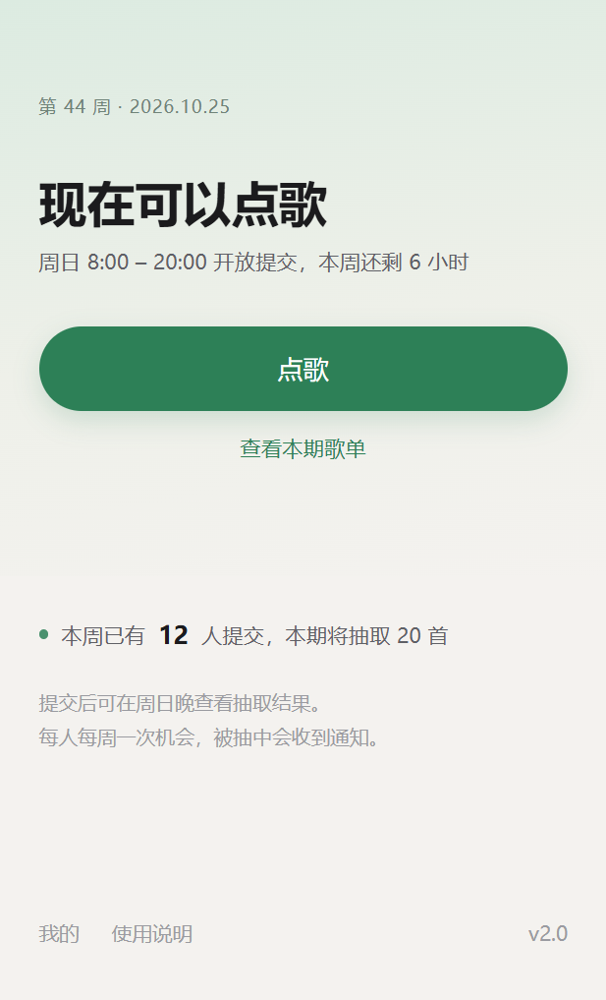

第二版修正了第一版的设计错误：**开放时不再需要多点一次"点歌"按钮**，表单直接呈现。

- 标题保留在顶部，🎲 彩蛋入口仍在标题内（第一版漏掉了）；
- 管理入口从横条降级为右上角小图标，减少首屏干扰，管理员仍可进入；
- 状态合并成一行：`通道开放中 · 还剩 6 小时 · 已有 12 人提交`，等宽数字；
- 表单四个字段无框化，只有一条极淡底线，聚焦时底线变主色 + 淡光晕（对应七条规则②）；
- 主按钮是整屏唯一高饱和色块；
- 歌单入口做成整块可点卡片，标题写"已发布歌单"、副标题"共 3 期 · 可查看往期"，并有"新一期已发布"角标——比第一版的文字链接明显得多。

#### 样张 D：首页 · 通道关闭


关闭态是本次重设计的重点：第一版写"现在不能点歌"确实很怪。改为**描述"已经发生什么"和"下次什么时候"**：

- 状态：`本周点歌已结束`（灰点，不用绿色，避免看起来仍开放）；
- 副行：`下次开放：11 月 1 日 周日 8:00`，把"等待"变成"有明确时间点的期待"；
- 顶部渐变改为中性暖灰，不沿用绿色（绿色在此处会误导）；
- 主体只保留两件可做的事：看本期歌单（带 3 首预览）、看往期歌单；
- 底部一句提示："可以提前准备好歌名，开放当天再来"。

#### 样张 B：本周歌单（浅色）

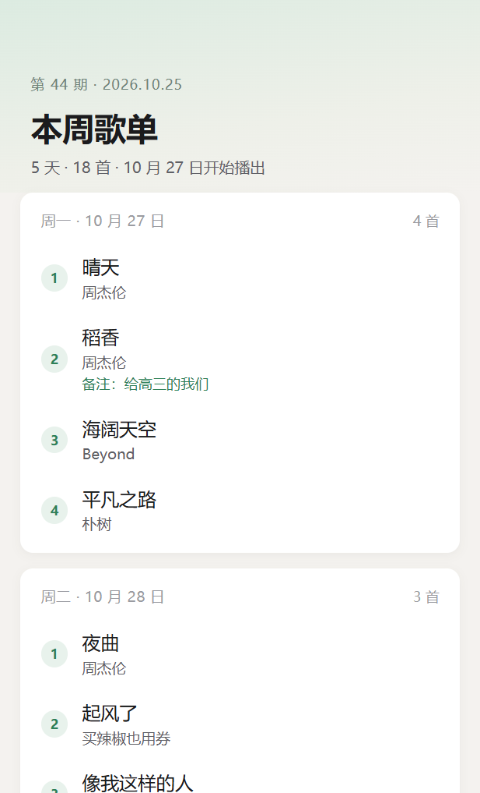

- 每天一张卡片（`--surface` 纯白，圆角 20rpx，极轻阴影），页面底 `#f4f2ef`；
- 卡片内无分隔线，靠行间距与字号拉开层次；
- 序号做成圆形徽记（`--accent-weak` 底 + `--accent` 字 + 等宽数字）；
- 歌名 14.5px/500，歌手 11.5px 次级色；备注用主色小字；
- 右上角有「往期 ›」入口；
- **日期已修正**：2026-10-25 是周日，播出从 10 月 26 日（周一）开始（第一版误写为 27 日）。

#### 样张 C：同一页面深色版

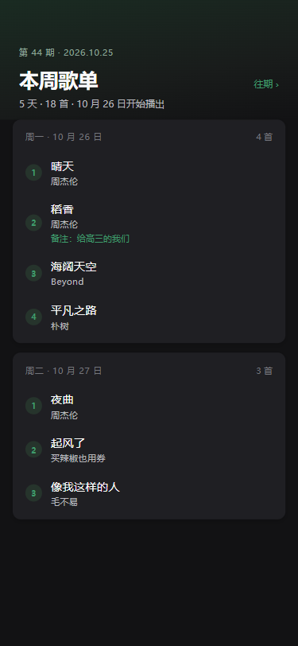

- 深色下卡片必须比背景亮一档（`#1f1f23` vs `#121214`），否则阴影在黑色上不可见、分层消失；
- 序号徽记底色由 `#1e2a24` 提到 `#26342c`，否则在深色卡片上几乎看不到；
- 文字主要靠提亮保证对比（`#fafafa`），字重只从 400 提到 500；
- 渐变改为深绿到近黑，保留"每周氛围"但不刺眼。

#### 出图方式（可复现）

三份 HTML 在 `mockups/`，用浏览器 375×812 视口渲染后截图即可。关键设两点：HTML 需带 viewport meta，浏览器需开设备模拟；否则移动模拟下视口默认为 980px，版面会错位。

---

## 五、设计规范（token）

### 5.1 颜色（18 个，含深色）

| 变量 | 浅色 | 深色 | 用途 |
| --- | --- | --- | --- |
| `--bg` | `#f4f2ef` | `#121214` | 页面底色（暖灰，与卡片拉开 ≥4% 亮度差） |
| `--surface` | `#ffffff` | `#1c1c1f` | 卡片、输入框 |
| `--surface-2` | `#edebe7` | `#26262a` | 次级面、输入框、禁用态 |
| `--line` | `#e8e6e2` | `#2e2e33` | 分隔线（尽量少用） |
| `--text-1` | `#1b1b1d` | `#f2f2f4` | 主文字 |
| `--text-2` | `#5f6066` | `#a8a9ae` | 次文字 |
| `--text-3` | `#9a9ba1` | `#75767c` | 弱文字、辅助说明 |
| `--accent` | `#2d8057` | `#3f9b6c` | 主色（沿用现有彩蛋绿） |
| `--accent-weak` | `#e8f2ec` | `#1e2a24` | 主色浅底 |
| `--danger` | `#d64545` | `#e06a6a` | 危险、删除 |
| `--danger-weak` | `#fbeceb` | `#2c1f1f` | 危险浅底 |
| `--warn` | `#b7791f` | `#d9a044` | 提醒、非本周排期 |
| `--warn-weak` | `#fdf3e3` | `#2d2519` | 提醒浅底 |
| `--info` | `#2f6fb3` | `#5b9dd9` | 信息、提示 |
| `--info-weak` | `#eaf1fa` | `#1c2632` | 信息浅底 |

> 放弃 `#07c160`（微信官方绿）：饱和度偏高、且容易让人误以为是小程序原生按钮。
> 现状中的 `#1976d2` 与 `#e53e3e` 分别并入 `--info` 与 `--danger`。

### 5.2 字号（7 档）

| 变量 | 值 | 用途 |
| --- | --- | --- |
| `--font-xs` | 20rpx | 辅助说明、脚注 |
| `--font-sm` | 24rpx | 次要文字、歌手名 |
| `--font-md` | 28rpx | 正文 |
| `--font-lg` | 32rpx | 小标题、歌名 |
| `--font-xl` | 38rpx | 页面标题 |
| `--font-2xl` | 46rpx | 大标题、弹窗标题 |
| `--font-3xl` | 64rpx | 强调数字（如"3/12"） |

### 5.3 圆角（4 档）

| 变量 | 值 | 用途 |
| --- | --- | --- |
| `--radius-sm` | 8rpx | 小标签、序号圆点外框 |
| `--radius-md` | 14rpx | 输入框、小按钮 |
| `--radius-lg` | 20rpx | 卡片、弹窗 |
| `--radius-pill` | 999rpx | 胶囊按钮、头像 |

### 5.4 间距（6 档，4 的倍数）

| 变量 | 值 |
| --- | --- |
| `--space-1` | 8rpx |
| `--space-2` | 12rpx |
| `--space-3` | 16rpx |
| `--space-4` | 24rpx |
| `--space-5` | 32rpx |
| `--space-6` | 48rpx |

### 5.5 阴影（2 档）

| 变量 | 值 | 用途 |
| --- | --- | --- |
| `--shadow-sm` | `0 2rpx 8rpx rgba(0,0,0,.04)` | 卡片默认 |
| `--shadow-md` | `0 8rpx 24rpx rgba(0,0,0,.08)` | 浮层、弹窗 |

---

## 六、逐页改造清单

### 6.1 首页（pages/index）

**现状文件**：`index.wxml` 124 行、`index.js` 373 行、`index.wxss` 195 行。

**现状功能清单（改造必须全部保留，共 12 项）**：

1. 测试模式横幅（`isTestMode`）
2. 管理员入口（`userInfo.role` 为 admin/superadmin 时显示，跳 `goAdmin`）
3. 标题 + 🎲 彩蛋入口（`onSecretDiceTap`，带 `diceShakeStyle` 摇动反馈）
4. 副标题"每周日 8:00-20:00 开放提交"
5. 状态徽章（`canSubmit` 区分开放/关闭）
6. 本周提交计数（仅在开放、有提交、且未发布时显示）
7. 已提交状态卡片（`hasSubmitted` + `submittedInfo`）
8. 提交表单：验证码 / 内容名称 / 补充说明（即歌手）/ 特殊备注，含 `loading` 态与长度限制（20/50/50/50）
9. 通道关闭卡片
10. "最新列表已发布"提示（`schedulePublished`）
11. 查看已发布列表入口（`goPlaylist`）
12. 关于 · 使用说明入口（`goAbout`）、底部 `statusMsg` 临时提示、隐私弹窗组件、彩蛋组件

**功能对照表（新版位置）**：

| 原功能 | 新设计位置 | 变化 |
| --- | --- | --- |
| 测试模式横幅 | 顶部通栏 | 保留 |
| 管理员入口 | 标题右侧 ⚙️ 图标 | 由横条降级为图标，减少首屏干扰 |
| 🎲 彩蛋入口 | 标题内 | 保留（第一版曾漏掉） |
| 标题 | 顶部左侧 | 保留 |
| 副标题 | 并入状态行；关闭时改为"下次开放时间" | 信息更具体 |
| 状态徽章 | 状态行（圆点 + 文字） | 去掉背景色块，改为更轻的表达 |
| 提交计数 | 状态行内 | 合并，等宽数字 |
| 已提交卡片 | 三态之一 | 视觉重做，信息不变 |
| 表单四字段 | 开放态直接显示 | 无框化；**不增加任何点击** |
| 通道关闭卡片 | 关闭态主视图 | 文案重写为"本周点歌已结束 + 下次开放时间 + 可做的事" |
| 最新发布提示 | 歌单入口卡片角标 | 合并 |
| 查看已发布列表 | 歌单入口卡片 | 整块可点，写明"共 3 期 · 可查看往期" |
| 关于 · 使用说明 | 底部文字入口 | 保留 |
| statusMsg | 底部临时提示 | 保留 |
| 隐私弹窗 / 彩蛋组件 | 不变 | 保留 |

**三态设计**：

| 状态 | 显示内容 |
| --- | --- |
| 开放且未提交 | 表单（直接可见）+ 提交按钮 + 歌单入口 |
| 已提交 | 已提交卡片（提交内容 + 等待抽取） |
| 通道关闭 | 本周已结束 + 下次开放时间 + 本期歌单（带预览）+ 往期入口 |

**关键约束**：
- **开放时零额外点击**：不允许把表单收进抽屉或折叠；
- **关闭时不说"不能点歌"**：改为陈述已发生的事实 + 明确的开放时间；
- **彩蛋入口不可丢**：它挂在标题里，是本项目唯一的趣味入口。

### 6.2 已发布列表（pages/playlist）

**现状**：用户已确认 F.2，正式页面代码已替换为 F.2 的主卡片布局，尚未上传发布；下述 E 为历史探索。

**当前待评审方向（E 样稿）**：
- 连续列表按周一至周五分组，不为每天增加外层卡片；日期和留白承担分组作用。
- 三期切换使用轻量标签；顶部只保留一行播出日期范围和实际总数，不再额外展示以周日为标识的期次日期。
- 歌名加大加重，歌手为次级文字；日期以小标题和细线分组，备注使用缩进和标记，管理员说明单独分区；序号弱化，移除重复的每日首数，长文本完整换行。
- 发布提醒位于内容标题右侧，保留铃铛与文字；不占微信原生胶囊，订阅仍对应当前投稿周期。复制说明只在页头出现一次，长按仍复制完整信息。
- 样稿外部可选择浅色、深色或跟随系统，统一替换文字、背景、细线、强调与按下/提示状态的语义颜色；仅为预览，不代表正式配置已改。
- 保留空日、整期无曲目、未发布、加载失败、缓存提示与管理员说明。
- 正式实施前确认样稿；实施时保留三期与往期直达、订阅、完整复制、下拉刷新、缓存校验及撤回清除、隐私与数据域。发布提醒对应当前投稿周期，不随历史标签改变。

**F 对照方案（首页风格延续）**：
- 使用首页相同的暖灰/白色内容面、10px 卡片圆角和轻阴影。F.2 共用一个渐变背景，导航、标题、工具区透明衔接，起始色/中间色/底色使用变量，供后续主题复用；保留渐变，不以独立标题色块切断页面。
- 标题与提醒、左对齐三期标签、日期范围/总数和复制提示均在卡片外。主卡片从周一上方开始，仅包含日期分组、曲目和广播站说明；日期分组仍平铺，不新增每日外层卡片。
- 序号改为与首页预览呼应的 24px 淡绿圆形；保持 E.2 的歌名优先、歌手次级、备注缩进，以及时间去重和提醒右置。
- F 独立文件带 E 版对照链接，沿用七种状态、四档宽度、浅色/深色/跟随系统及演示交互。F.2 布局已接入正式页面代码，E 保留作对照；HTML 深色并不代表正式深色已完成，业务规则不变。

早期 B/C 的每日卡片、圆形序号与顶部渐变仅留作历史对照，不作为本轮实施依据。

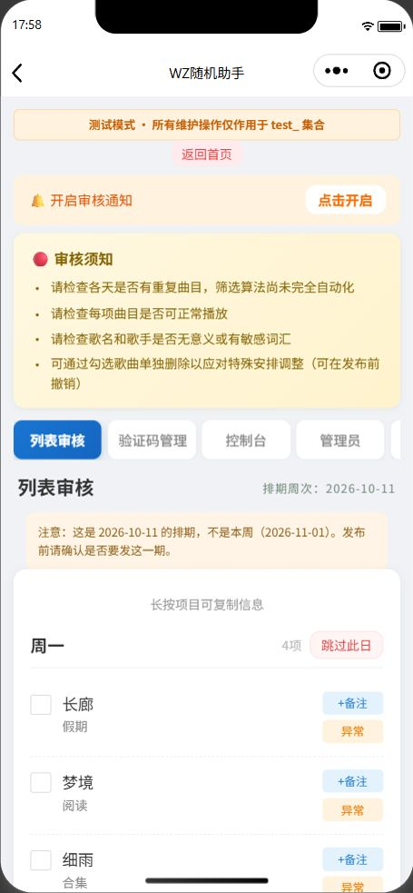

### 6.3 彩蛋（components/easter-dice）

**现状**：已是全屏沉浸式，最接近倒带风格，但颜色与字号自成一套。

**改造**：
- 全部数值并入 token（颜色、字号、圆角）；
- 照片展示框保持现有「按比例定高」逻辑；
- 遇见统计文案从 20rpx 提到 24rpx（当前偏小）；
- 增加「图鉴」入口（骰子页底部）。

### 6.4 管理后台（pages/admin）

**改造**：
- 仅做 token 替换与重复样式合并（19.7KB 中大量重复的卡片/按钮写法）；
- 周次提示、跨周警告改用 `--warn` / `--warn-weak`；
- 不改布局（工具属性，稳定性优先）。

### 6.5 说明页 / 关于页

G 版经用户确认后已接入。说明页采用渐变页头加一个白色折叠内容面，保留标题、摘要、正文与图片层级；关于页采用介绍卡片与使用说明/反馈/管理员轻量列表。隐私指引与署名在自然流中放到页面底部：短页靠近下沿，长页接正文，保留安全区，不悬浮遮挡。共享 `styles/info-pages.wxss` 与现有自定义导航，新增一个小型本地箭头 SVG；动态数据、折叠节点、图片缓存/预览/重试和各入口保留。后续按用户反馈将关于入口标题加大到 32rpx/600；说明每条上限十图、只显示前四张缩略图和剩余计数，原生大图保留完整列表，管理员编辑区仍可管理全部图片。十图云函数已部署并回读，兼容 1.8，前端尚未发布；旧版仍保留旧选择上限和展示方式。HTML 保留固定样例与深色预览；用户按 Esc 停止界面操作后未继续，正式模拟器最终视觉和真机待验收。

---

## 七、我的页面与个性化（2026-10-27 定稿，待实施）

> **用户最新要求（2026-10-27）**：本章先评审讨论，暂不开发。下方DeepSeek原稿保留，“定稿/下一轮可开工”不代表本轮获得实施授权；评审建议单列在7.9，尚未定为新规则。

> 本章只定方案、不写代码。所有"不做"的决策都记下理由，避免下一轮重复讨论。
> 下一轮可直接按 7.7 的分层顺序开工。

### 7.0 已确定不做的事

| 决定 | 理由 |
| --- | --- |
| **不接第三方音乐平台取歌曲信息** | 网易云 / QQ 音乐都没有面向第三方的官方开放接口，能接的都是非公开接口，随时失效；且本项目类目是「教育 > 校园服务」，提审口径明确回避"音乐/听歌/播放"，接入音乐数据有实质审核风险；维护成本远高于收益 |
| **不做"最喜欢的歌手"** | 该功能依赖第三方元数据，第三方方案取消后随之取消 |
| **不实时调用 `filter: blur()`** | 全屏背景图做高斯模糊在低端安卓明显掉帧，且模糊半径越大越贵；改为**上传时预渲染** |
| **不做图片自动提取主色** | 提取结果经常不可用（主色可能是灰褐、杂色），强制套用会做出难看界面；改为**换图后让用户自己挑** |
| **背景图不上传云端** | 仅在本机使用，避免存储成本与内容安全审核；代价是换设备后背景丢失（须在界面上说明） |

### 7.1 页面定位与入口

- 「我的」是独立页面，布局**直接复用关于页那套**（`styles/info-pages.wxss` + `app-navigation` + `info-head` / `info-surface` / `info-footer`），保证两页观感一致；
- 定位：低频页面（用户大约一周来一次），打开就应该能一眼看完，不要设计成需要逐层点进去的结构；
- 入口：首页底部保留轻量文字入口。**具体放法待定**（见 7.8），暂定首页底部并排「我的」与「关于」两个文字入口。

### 7.2 页面结构（自上而下）

```
[app-navigation back]
[info-head]
  「我的」标题 + 外观切换按钮（复用 appearance-toggle）
  副标题一句话
[info-content]
  ┌ 身份卡 ────────────────────────┐
  │ 自定义名称（未设置时显示"点歌同学"，右侧"修改"）│
  │ 称号：由近六个月入选次数生成（见 7.3）        │
  └────────────────────────────────┘
  ┌ 本周 ──────────────────────────┐
  │ 本周点歌：待抽取 / 已入选 / 未入选 / 已超额 / 未通过 │
  │ 一行显示歌曲名与提交时间                     │
  └────────────────────────────────┘
  ┌ 记录 ──────────────────────────┐
  │ 历史点歌 N 次            →  查看详情  │
  │ 近六个月入选 M 次                    │
  └────────────────────────────────┘
  ┌ 外观 ──────────────────────────┐
  │ 主题色：色块选择器（4–6 套预设）        │
  │ 背景：无 / 预设渐变 / 自定义图片        │
  │ 遮罩浓度：滑块                       │
  └────────────────────────────────┘
[info-footer]
  版本号 + 隐私指引（与关于页一致）
```

### 7.3 数据需求

#### 本周点歌状态

数据来源：`submissions`（本周记录已存在，无需新建集合）。

状态映射（**界面上不要直接显示英文状态**）：

| 存储状态 | 界面说法 | 含义 |
| --- | --- | --- |
| `pending` | 待抽取 | 已提交，周日晚抽取前 |
| `selected` | 已入选 | 被抽中并已排进本期歌单 |
| `carryover` | 未入选（已转入候补） | 本周没抽中，下周还有机会 |
| `overflow` | 已超额 | 超过 250 条上限，未进入抽取池 |
| `rejected` | 未通过 | 审核阶段被移除 |

#### 历史记录与统计（需新建集合）

现有 `submissions` 只保留本周与前两周，**无法支撑 6 个月历史**，必须新建集合。

新建集合 `user_records`（测试域 `test_user_records`）：

```
{
  _id: string,
  user_id: string,          // openid
  week_key: string,         // 'YYYY-MM-DD'
  song_name: string,
  singer: string,
  status: string,           // pending / selected / carryover / overflow / rejected
  submitted_at: serverDate,
  updated_at: serverDate
}
```

写入与更新时机：

| 时机 | 动作 |
| --- | --- |
| `checkWeeklyCode` 提交成功 | 插入一条，status 按当时结果 |
| `drawWeeklyPlaylist` 抽取完成 | 把被抽中的记录更新为 `selected` |
| `adminAuditPlaylist` 发布 | 残留 `pending` → `carryover`；待删除项 → `rejected` |
| 清理任务 | 删除 `submitted_at` 早于 6 个月的记录（可并入 `drawWeeklyPlaylist` 现有清理段） |

统计口径（都从 `user_records` 实时 count，不需要额外计数器）：

- 历史点歌次数 = 该用户记录总数；
- 近六个月入选次数 = `status = 'selected'` 且时间在 6 个月内；
- **首次上线时历史为空**，界面须显示"从 xxx 开始记录"，不要假装有终身数据。

#### 自定义名称

`users` 集合增加字段 `name_alias`（长度 2–12，禁止纯空白与特殊符号，走内容安全校验）。未设置时不显示该行名称，回退为"点歌同学"。

#### 称号（入选次数 → 鼓励话语）

| 近六个月入选次数 | 称号示例 | 说明 |
| --- | --- | --- |
| 0 | 「还在路上」 | 配一句鼓励，不要用"运气不好"这类负面对比 |
| 1–3 | 「有点小运气」 | |
| 4–9 | 「手气不错」 | |
| 10+ | 「欧皇附体」 | |

称号文案可随机取同档位的 2–3 句，避免每次看到同一句。

**视觉程度待定**（见 7.8）：先做"文字 + 一个小徽记"，不做整套等级视觉。

### 7.4 外观设置

#### 主题色

`utils/theme.js` 的 `PALETTES` 已支持多套配色（当前只有 `green`）。本轮**只加配色，不改机制**：

- 新增 4 套：暖橙、靛蓝、绛紫、墨灰（每套都要同时给 light / dark 两版）；
- 业务状态色（`STATES`：成功/危险/警告/信息/候补）**不随主题变色**，这是既有正确设计，不要动；
- 每套配色必须在深色模式下单独给定 `accent`（不能简单反相）。

#### 自定义背景（仅本地）

流程：`wx.chooseMedia` 选图 → 裁剪成固定比例 → 压缩到 750px 宽 → **预渲染模糊版** → `wx.saveFile` 存本地 → 记录路径与遮罩浓度。

**预渲染模糊的做法**（关键，替代实时 `filter: blur()`）：

1. 选图后用 canvas 缩到约 60×130，再绘制回 750px 宽的画布 —— 低分辨率放大天然形成柔和模糊，成本极低；
2. 如需更强的模糊，再对这张小图画一次 `ctx.filter = 'blur(4px)'`（只发生一次，不影响运行时）；
3. 保存成品图（目标 ≤ 200KB），运行时只做普通 `<image>` 显示，**不做任何实时滤镜**。

#### 遮罩浓度

滑块控制背景图上方遮罩的透明度（建议 20%–60%），而不是控制模糊半径。无论遮罩多淡，正文文字层始终保证对比度 ≥ 4.5:1（必要时自动加深遮罩）。

#### 背景与主题色的关系

**不做自动提取主色**。用户换背景后，主题色保持用户自己选的那个；如果两者冲突（例如深绿主题配浅黄背景），由遮罩层负责可读性，不强行改主题色。

### 7.5 猫咪图鉴（保留原方案）

- 入口：彩蛋弹窗骰子页底部（现有进度点位置改为可点按钮"🐾 图鉴 3/12"），「我的」页同时提供入口；
- 内容：12 种文字猫 + 照片条目，已解锁正常显示，未解锁显示剪影 + 提示语；
- 数据：`utils/easter-encounters.js` 本地记录，无需新云函数；
- 边界：换设备或清缓存后记录丢失，界面须说明。

### 7.6 关键实现约束

| 约束 | 说明 |
| --- | --- |
| 复用现有布局 | 用 `info-page` / `info-head` / `info-surface` / `info-footer`，不要新造一套 |
| 复用主题机制 | 用 `utils/theme.js` 的 `setPreference` / `subscribe` / `appearance-toggle`，不要另写一套切换逻辑 |
| 本地存储键 | 一律走 `storageKey()`，测试域与正式域隔离 |
| 深色模式 | 所有新增界面必须在深色下检查，尤其背景图 + 遮罩组合 |
| 首页不改结构 | 本轮只加底部入口，不动首页主体布局 |

### 7.7 实施分层

| 层 | 内容 | 是否动数据库 | 预计 |
| --- | --- | --- | --- |
| **第一层** | 我的页框架、本周状态、自定义名称、4 套预设主题色、背景（预设渐变 + 自定义图片 + 遮罩） | 否（自定义名称写 `users` 一个字段） | 1–2 天 |
| **第二层** | `user_records` 集合、6 个月历史、入选次数与称号、明细列表页、清理任务 | **是** | 3–5 天 |
| **第三层** | 猫咪图鉴接入我的页（本地数据） | 否 | 1 天 |

第二层涉及云端写入，开工前必须先把集合、字段、清理策略和回滚方式确认清楚。

### 7.8 待确认

1. **首页入口放法**：并排「我的」「关于」两个文字入口，还是首页只留「我的」、把「关于」收进我的页？
2. **称号的视觉程度**：纯文字，还是文字 + 小徽记？是否要随称号改变称号区域的配色？
3. **称号档位**：0 / 1–3 / 4–9 / 10+ 四档是否合适？
4. **背景丢失提示**：换设备后自定义背景消失，需要在界面上写多明显的提示？

---

### 7.9 本轮评审建议（2026-10-27，待讨论，不实施）

- **先保持首屏轻量**：建议“我的”首页放本周状态、记录摘要和外观入口；裁剪背景、遮罩滑块等详细设置另开界面，避免为了“一屏看完”缩小文字或塞满卡片。首页仍沿用用户已提出的“关于 · 我的”两个轻量文字入口，不重新默认只剩“我的”。
- **第一层边界需澄清**：`users.name_alias`是云端写入，跨设备同步涉及本人接口、内容校验及旧版本兼容，不能称为完全不动数据库。若先本机改名，应明确只在本机显示；选择尚待讨论。
- **状态要以真实流程表达**：`selected`在抽取后、正式发布前就可能出现，发布前宜称待审核/待发布，最终发布后再表达已入选；`overflow`不能直接显示“已超额”，否则改变现有无感知上限的产品口径。具体文案未在本轮实现。
- **六个月记录要统一口径**：界面统一写近六个月或从某日开始记录，不称终身历史；入选统计以最终已发布歌单为准。后续需设计投稿唯一关联、历史候补跨周入选、编辑/撤回后的同步与幂等更新，不能只在抽取时加一次计数。
- **背景优先保证阅读**：图片仅本地预处理与保存，原稿的“上传时”不应理解为上传云端；预渲染避免实时滤镜的方向可保留，但不能仅凭固定20%–60%遮罩保证任意图片上的文字可读。建议正文内容面保持稳定底色，再讨论背景适用范围、丢失时的降级和具体处理能力。
- **实施顺序建议**：框架/本周状态/预设配色先评审，背景设置另做预览；图鉴已有本机记录，可早于新增历史集合。六个月记录涉及后端，单独设计、验证和授权。此顺序为建议，不取代原三层方案，待用户讨论后确定。

## 八、实施顺序

以下为当前推进顺序；后续功能范围和工期仍需确认。

| 顺序 | 内容 | 当前状态 / 验收 |
| --- | --- | --- |
| 1 | 公共变量、首页三态与提示去重 | 代码已完成；继续小屏、键盘与普通账号真机验收，发布状态另行核验 |
| 2 | 歌单页连续列表 | F.2 已确认并接入，保留原有功能；继续普通账号真机验收，待上传发布 |
| 3 | 深色基础与临时切换 | 九页、隐私/彩蛋、SVG与系统导航代码已接入；系统跟随/每页切换/本机保存，50项测试通过，待真机与发布 |
| 4 | **我的页面（第一层）** | 方案已定稿（见第七章）。内容：页面框架（复用关于页布局）、本周点歌状态、自定义名称、4 套预设主题色、自定义背景（预渲染模糊 + 遮罩）。不动数据库结构 |
| 5 | **我的页面（第二层）** | 新建 `user_records` 集合 → 6 个月历史、入选次数与称号、明细列表、清理任务。开工前先确认集合字段与回滚方式 |
| 6 | **我的页面（第三层）** | 猫咪图鉴接入我的页（本地数据，无需云函数） |
| 6 | 猫咪图鉴与个人足迹 | 待开发；足迹先明确累计统计与历史清理边界 |
| 7 | 管理后台视觉统一 | 按公共变量逐步整理；现有 19 个测试文件通过，并完成受影响路径真机验收 |

## 九、技术风险与对策

| 风险 | 说明 | 对策 |
| --- | --- | --- |
| 模糊滤镜性能 | `filter: blur()` 在低端安卓掉帧 | 不用模糊，改用 CSS 渐变 |
| 沉浸式状态栏适配 | 首页/歌单/说明/关于已接入自定义导航，机型差异仍需真机核验 | 测量状态栏/胶囊、保留系统图形和安全占位；直接打开可回首页，管理页仍原生导航 |
| 自定义背景性能 | 大图拖慢首屏 | 压缩 750px / ≤200KB + 缓存到本地文件 |
| 字体 | 自定义字体拖慢首屏 | 沿用系统字体 |
| 变量抽取回归 | 改动面大 | 先备份、每阶段跑测试、截图对照 |

## 十、过程记录

### 深色基础、每页切换、本人投稿分行及计数移位（2026-10-26，美国东部时间）

- 开工备份 `acffccd` 已推送，保留另一路云函数提交 `6dc4d79`。用户授权先做深色，随后要求每页临时浅深切换；我的及 `Progress/design/my-page/` 留给并行讨论，本轮不改，首页原有入口保留。
- `utils/theme.js` 作为唯一颜色源，分中性色/品牌色/状态色，`node Progress/build-theme.cjs` 生成公共WXSS和系统主题；九页经页面包装与page-meta接入，组件保持原生命周期与监听清理。默认系统跟随，手动选择本机保存并广播；图标随色生成SVG，照片不滤色。原生确认框按实际系统底色取色。
- 本人投稿按歌名/歌手/可选备注纵向完整换行，新缓存保存备注，旧缓存回源补齐，离线保留。计数从未提交表单底部移至标题区提示语下面，原读取及零值隐藏不变。
- 新增主题8项与投稿2项回归，共21文件50项通过；正文和辅助文字最低对比度浅色4.56、深色5.78。静态检查排除`.cache`下载备份，覆盖项目自有71JS/42JSON/13WXML。
- 模拟器已查看首页、歌单正常/加载/未发布、关于与说明的深色表现、返回与提醒SVG；另用仅页面内存的长文本/23人示例核对投稿分行与计数位置，重新编译后已清除，未落库。浅色选择在重新编译后保持；未做订阅写入或业务数据库操作。普通账号真机、管理端特殊状态与系统弹窗仍待验收；不将单元测试等同于真机。未上传发布或部署云函数。

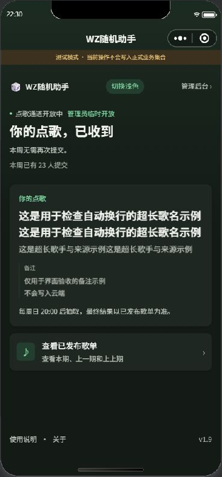

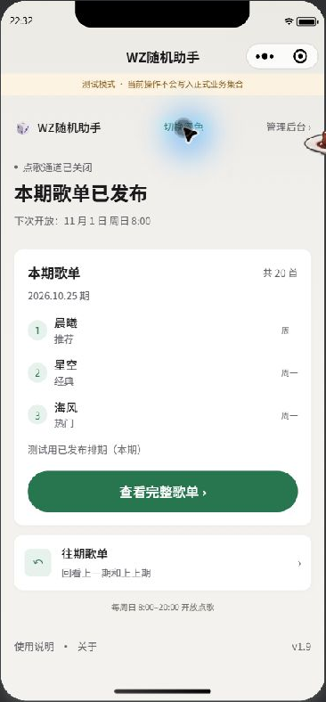

### 十图云函数部署与下一步入口讨论（2026-10-26，美国东部时间）

- 用户授权“兼容 1.8 就直接部署”。线上下载 index 与 `0c9b5f1` 的 1.8 基线一致，本地只扩大五图到十图并加超限提示；原接口、数组和文件ID格式保持。部署前备份 `10a78a3` 已推送。
- 只增量部署 `manageHelpContent/index.js`，`Active`，Nodejs16.13/20秒不变。回读2066文件，仅 index 改变且 SHA256 与本地一致；其余2065文件保持部署前原样，未改数据、环境变量或前端版本。
- 首页最新讨论方向从单个收纳入口改为轻量「关于 · 我的」；说明放关于，外观/图鉴/足迹放我的。建议先深色基础，再我的轻量版与外观手动选择，之后主题背景与累计足迹。本轮只记录讨论，不改布局或新建正式页。

### 关于入口字号与说明十图/四缩略图（2026-10-26，美国东部时间）

- 用户提供关于页截图，要求三个入口更醒目；标题由 28rpx/500 改为 32rpx/600，副说明保留原字号。
- 每条说明最多十图，用户端只创建/准备前四张缩略图；第四张提示剩余数量，点击后仍从该图开始浏览完整原生大图列表。管理员用户端预览同步四图，编辑区保留十图排序/删除。
- 管理端每批至多九张、可继续补齐十张，增加选择锁和保存前上限检查；服务端拒绝十一张，单图大小/格式和超管校验不变。`manageHelpContent` 扩容源码尚未部署。
- 开工备份 `1596a07` 已推送；新增行为回归与服务端边界校验，现有 20 个测试文件共 40 项通过。未继续界面操作，未上传发布或部署云函数。

### G 版接入与底部隐私署名（2026-10-26，美国东部时间）

- 用户后续明确“我觉得没问题”，并要求隐私保护指引、@发牌的小度 移到最下方；因此接入正式说明与关于。页脚采用自然流的弹性留白，不固定覆盖内容。
- 共用连续渐变、自定义导航、公共字号/圆角/边距；说明使用一个折叠内容面，关于使用介绍与轻量入口。原 JS 不改，保留真实数据、图片、重试与入口行为。
- 开工备份 `ca46dea` 已推送；现有 19 文件 35 项回归通过。浏览器刷新后可切换到新版关于，截图/正式模拟器检查被用户按 Esc 停止；待后续实际验收，不宣称已验证小屏、深色或真机。

### 说明/关于 G 版预览（2026-10-26，美国东部时间，待评审）

- 新增 `mockups/G-info-pages.html`，继承 F.3 的渐变、内容面、圆角、字号和边距，分别展示折叠说明及轻量关于页。SVG 只作内联样例，无外部字体或依赖。
- 浏览器已展示说明和关于两页；示例为固定内容，图片为自制示意，反馈/管理员/隐私仅提示入口，正式两页源文件未改。
- 用户答复“等会儿，还没看”；继续保留预览，等评审后接入，不默认批准。对齐、内边距与圆角关系作为后续正式实施的校核点。

### F.3 日期标题与无卡片状态（2026-10-26，美国东部时间）

- 按用户要求加大加重日期范围，使其与曲目总数形成主次；未额外重复期次日期。
- 加载/未发布/无缓存读取失败使用无卡片的大状态标题与短提示，失败保留重试；已发布零曲目及管理员说明继续放在主卡片内。
- 正式页仅改 WXML/WXSS，同步 F HTML 预览，不改数据、订阅或复制。改动前备份 `448d253` 已推送。按用户最新顺序，后续先处理说明与关于，并检查共同边距、视觉基线、图标和嵌套圆角。

### F.2 正式接入、首页连续渐变与自定义导航（2026-10-26，美国东部时间）

- 用户确认 F.2，正式歌单接入主卡片、卡外左对齐期次工具、时间去重、提醒右置、分组与完整备注/说明；不修改订阅周期、权限或云端。
- 首页的局部斜角渐变改为整页垂直淡出；两页与固定顶部使用同一组起始/中间/底色变量和 420px 淡出距离，消除区块边界。仅两页配置 `navigationStyle: custom`，根据状态栏和胶囊测量，保留系统时间/电量/胶囊及返回/直接打开回首页。
- 新增三期缓存/撤回、失败重试、迟到响应、跨年日期、复制和订阅周期回归。小程序原生按钮伪元素导致下划线位置错误已修正；已开启提醒改为普通状态文字，消除禁用按钮白底。
- 按需加入三个原创 SVG（20×20、1.5 线宽，共 677 字节），未安装整库。正式深色模式、SVG 深色配色与真机验收待下一步；本轮不上传发布。
- 开工备份 `361fb8a` 已提交并推送。依据：[微信官方 Navigation 文档](https://wechat-miniprogram.github.io/weui/docs/navigation.html)；组件独立实现。

### F.2 卡片边界、左对齐标签与连续渐变（2026-10-26，美国东部时间）

- 用户要求三期标签参考 E 左对齐，并把标签、日期范围、总数和复制提示全部移到卡片外；主卡片从周一上方开始。
- 用户指出深色标题背景分层割裂，随后明确保留渐变、改善过渡，并供后续主题换色复用。将渐变统一放在页面共同背景层，导航/标题/工具区透明，起始色、中间色与底色均由变量控制。
- 仅调整 F 样稿与文档，E.2、正式首页/歌单、公共样式和业务代码保持原样。改动前备份 `2d8099b` 已推送成功。

### F 与首页卡片风格统一的对照预览（2026-10-26，美国东部时间）

- 用户要求在 E.2 基础上另做 F，判断无边列表与首页卡片是否应更统一。新增 `mockups/F-playlist-card.html`，保留 E.2 文件原样。
- F 用暖灰底、白色主卡片、首页关闭态渐变、10px 圆角、轻阴影和淡绿序号呼应首页；整份歌单一个容器，内部按日期平铺，继承时间去重、提醒右置和文字层级。
- 保留三期、提醒、复制、刷新、七种状态、四档手机宽度及浅深色/跟随系统预览。均为固定数据演示，不接云端或真实订阅；首页和正式页面未改，等待 E/F 评审。
- 开工备份 `056d5ad` 已成功推送，按既有规范继续提交并推送验证后的结果。

### E.2 时间去重、提醒右置与深色预览（2026-10-26，美国东部时间）

- 用户指出顶部时间重复、主次不清，并希望发布提醒移到右上角。样稿移除期次日期，播出范围和总数合并一行；提醒置于内容标题右侧，歌名加大加重，日期分组弱化，备注缩进，广播站说明独立分区。
- 增加浅色/深色/跟随系统预览，深色采用独立语义配色。建议正式深色适配紧接歌单布局确认，早于主题色和背景个性化；手动切换与持久化随统一收纳页落地。
- 本次仍为同一 HTML 评审任务的迭代，正式页面、公共 WXSS、app.json 和云函数未修改。备份 `830c6b5` 已在本地建立，推送连接超时，继续沿用用户已授权的本地优先与联网补推安排。
- 本轮末连接恢复，E.2 提交 `a25f2de` 与此前积压/备份均已推送并回读确认；补推自动跟进已暂停，默认“先推送备份”规范继续有效。

### 歌单连续列表交互样稿与近期决策回填（2026-10-26，美国东部时间）

- 用户要求先制作 HTML 示例，再讨论正式改版。新增 `mockups/E-playlist-flat.html`，保持暖灰/白色/绿色体系，连续列表按日期分组，三期切换、通知入口和复制提示均轻量化。
- 预览含正常、长文本、未发布、空排期、读取失败、缓存与加载中七种状态，以及 320/375/390/430px 宽度。样例使用固定数据；提醒仅改变样稿内存状态，不申请订阅、不访问云端；曲目可长按、右键或键盘复制完整信息。
- 确认首页未来统一收纳低频功能，只保留轻量页脚入口；当前两个文字入口暂不替换，已撤回的大按钮不重新引入。
- 同步根目录设计约定、README、项目现状、历史更新和长期决策；每轮先推送备份的规范再次明确。本轮 GitHub 两次连接超时，用户允许先本地完成，待网络恢复补推送。

### 首页底部入口与本地时间文案（2026-10-26，美国东部时间）

- **最新结论**：用户否定下述大按钮方案，已恢复原文字入口与版本号布局；仅保留去除首页时区提示。后续先讨论布局再实现，下述内容作为一次已撤回的尝试保留。
- **后续选择**：低频功能统一收纳，首页只留一个轻量文字入口；尚未实现。
- 用户确认首页主要服务中国用户，去掉重复时区提示，时间计算仍为北京时间。
- 页脚采用“使用说明 ›”“关于 ›”两块并排的白色导航区域，正文级字号、至少 96rpx 高，分别直达原页面；版本信息单独居中弱化，不与链接争抢空间。
- 对比直接放大原小字，这种布局能更明确地表达可点击范围；比增加一个“更多”菜单少一步操作。后续新增“我的”页时再统一收纳外观和足迹，本轮不提前增加空入口。

### 首页信息去重与设计入口（2026-10-26，美国东部时间）

- 根目录新增 `DESIGN.md`，将当前已选定的规则与未来设想分开，供后续页面开发使用；公共变量仍以 `styles/tokens.wxss` 为准。
- 参考 `VoltAgent/awesome-design-md` 的组织方法，不把其品牌官网分析直接当作小程序方案。保留本项目已有基调。
- 圆点仅表示开放/关闭；发布结果留给大标题，卡片右上改为总曲目数；已提交状态的流程说明只保留在内容卡中。
- 当前为本地代码与文档调整，尚未推送、上传或发布。原有三态截图仍用于记录上一轮外观，不代表本轮文案。

### 首页第二轮实现（2026-10-25，美国东部时间）

- **状态**：本地代码完成；尚未上传、提审或发布。公共变量已建立，首页率先接入，其余页面仍保持原样。
- **主次**：应用名与管理入口缩为顶栏；状态 + 一句大标题解释当前能做什么；开放时表单直接可见，已提交时显示投稿结果，发布后以本期歌单为主要内容，往期/说明/关于为辅助入口。
- **识别**：字段文案改为“歌名 / 歌手或来源 / 特殊备注（选填）”，内部仍为 `title/remark/specialNote`；按钮写明“提交本周点歌”；管理员使用文字入口，保留标题骰子及原解锁规则。
- **补齐**：外层输入容器双环聚焦；本期最多三首真实曲目预览、动态总数、空排期备注；往期入口直达上一期；未发布与读取失败分开；加载阶段不抢先显示可提交表单。
- **时间与并发**：北京时间计算不变；末小时按分钟展示；强制关闭不承诺恢复日期；过期响应不能移除新投稿缓存或覆盖预览。
- **范围**：只改公共样式、首页展示、歌单页初始标签参数、相应测试与文档。没有改云函数、数据库规则、验证码校验、抽取逻辑或彩蛋概率。
- **验证记录**：`Progress/tests/home-state.test.js` 覆盖时间边界、三态、预览、测试/正式读取路径、强制开关、失败清理、并发、焦点、提交字段与路由参数。模拟器注入的预览数据只存于页面内存，不写入业务集合。
- **待验收**：普通账号体验版真机检查软键盘、聚焦双环、长文案、隐私授权及完整投稿流程；不能以模拟器和本地 mock 代替真机验收。

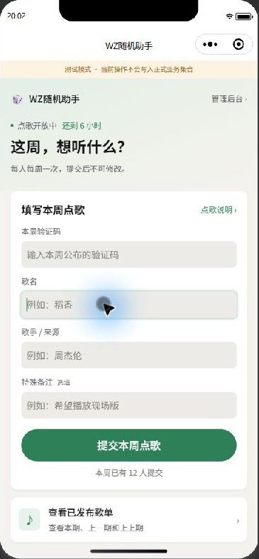

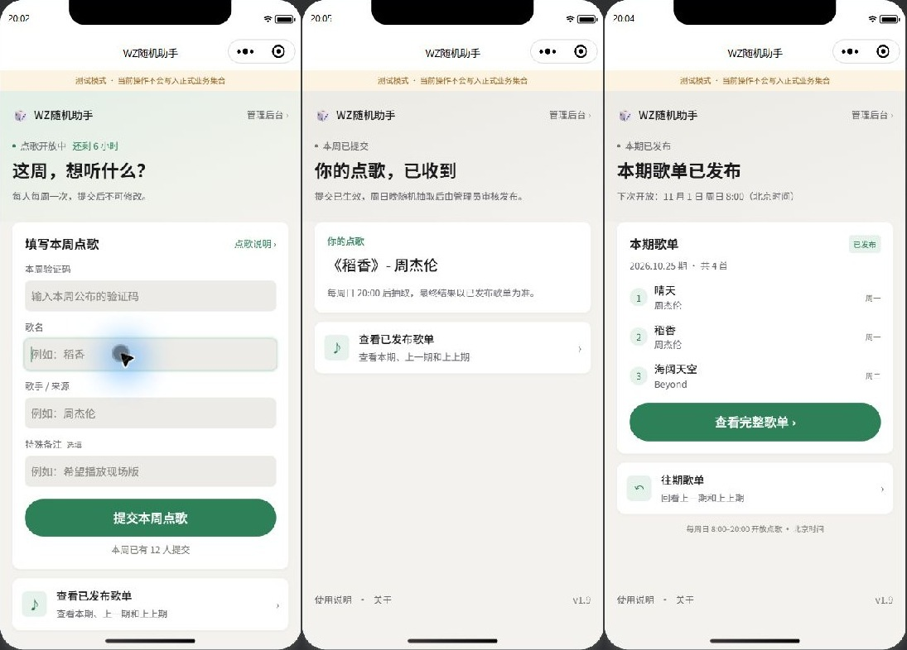

| 日期 | 阶段 | 截图 |
| --- | --- | --- |
| 2026-10-26 | 调研与方案（本文档建立） | `shots/rewind-app.webp`、`shots/before-admin-audit.jpg` |
